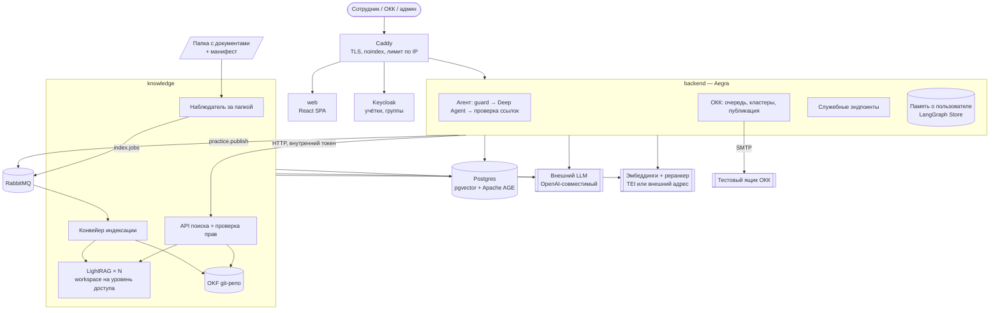
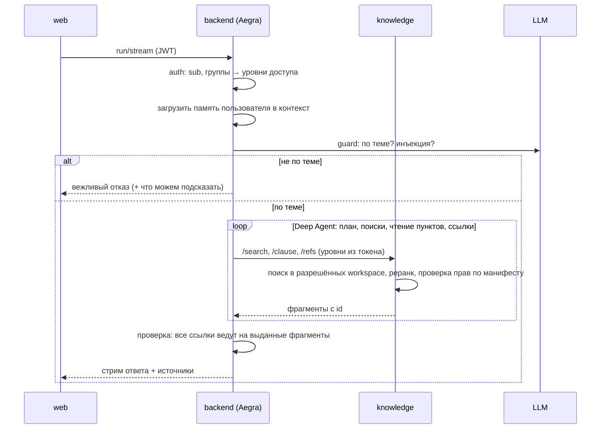

# 02. Архитектура

## Общая схема

## Сервисы

| Сервис | Что делает | Технологии |
| --- | --- | --- |
| `proxy` | Единственная внешняя точка: TLS, маршрутизация, `X-Robots-Tag: noindex`, robots.txt, лимит по IP | Caddy |
| `keycloak` | Учётки, группы уровней доступа, роли ОКК и admin, OIDC | Keycloak (версия без известных CVE на момент сборки) |
| `web` | Чат, страница ОКК, служебная страница | React + Vite + TypeScript, Tailwind, shadcn/ui |
| `backend` | Агент (Deep Agents на LangGraph), память, ОКК, служебные эндпоинты, лимит на учётку, письма | Aegra (сервер Agent Protocol) + свои HTTP-маршруты |
| `knowledge` | Наблюдение за папкой, парсинг, нормализация, OKF, индексация в LightRAG, поиск с проверкой прав, глоссарий | FastAPI + LightRAG как библиотека + потребитель RabbitMQ в одном процессе |
| `rabbitmq` | Очереди индексации и публикации практики | RabbitMQ |
| `postgres` | Все данные | Postgres с pgvector и Apache AGE (свой образ) |
| `embeddings` | Эмбеддинги и реранкер, если нет внешних | TEI (compose-профиль `local-embeddings`) |
| `mailpit` | Почта при разработке | Mailpit (профиль `dev`) |

LLM в compose нет: это внешний сервер, адрес и модели задаются в `.env`.

### Почему knowledge — один процесс

LightRAG координирует инициализацию хранилищ и конвейер документов через общую память процесса; несколько процессов, пишущих в один workspace, не поддерживаются. Поэтому индексация и поиск живут в одном процессе, а единственный писатель в OKF-репозиторий — тоже он. Масштабирование — потом и отдельным решением.

### Почему RabbitMQ при одном потребителе

Задачи приходят из двух мест (наблюдатель за папкой и публикации ОКК из backend), должны переживать перезапуск, повторяться при сбоях и падать в очередь ошибок. Брокер даёт это без самописной очереди в БД.

## Хранилища

| Где | Что |
| --- | --- |
| Postgres, БД `keycloak` | данные Keycloak |
| Postgres, БД `app` | чекпоинты и Store Aegra (диалоги, память о пользователе), таблицы ОКК, журнал запросов, счётчики лимитов |
| Postgres, БД `knowledge` | хранилища LightRAG (KV, векторы, граф AGE, статусы) с workspace на уровень доступа; реестр документов и задач; кандидаты глоссария; список «на сверку» |
| Том `docs` | исходные файлы и `manifest.yaml` |
| Том `okf` | git-репозиторий OKF: редакции документов, практика, глоссарий |

## Основные потоки

### Вопрос пользователя

### Индексация

Файл появился, изменился или исчез в папке (или изменился манифест) → наблюдатель сравнивает с реестром → задача `index.jobs` → конвейер: парсинг → нормализация по пунктам, ссылки, аббревиатуры → коммит концепта в OKF → вставка/замена/удаление в workspace своего уровня → статус в реестре. Подробно — [03-knowledge-service.md](03-knowledge-service.md).

### ОКК → практика

Вопрос без ответа (автоматически), заявка сотрудника или эскалация → таблица ОКК в backend, склейка похожих → письмо на тестовый ящик → эксперт на странице ОКК правит черновик и жмёт «опубликовать» → сообщение `practice.publish` → knowledge пишет запись в OKF и индексирует её в workspace уровня привязанного пункта → автор вопроса видит уведомление в чате.

## Конфигурация

Все настраиваемые параметры — в `.env` (полный список в [06-contracts.md](06-contracts.md#переменные-env)). В репозитории — `.env.example` с безопасными значениями по умолчанию; реальный `.env` не коммитится. Уровни доступа и их группы Keycloak — в `config/access_levels.yaml` (путь задаётся в `.env`).

## Развёртывание

**Стенд (Mac, с 27.11)** — `deploy/prod/README.md`. LaunchAgent раз в 2 минуты забирает `origin/main` и собирает релиз в отдельном каталоге со снимком `.env`. Перед переключением релиз проверяет:
- конфиг (D-38);
- адреса в сборке web (D-39);
- админка Keycloak за прокси отвечает 404 (D-47);
- вход под `employee_public` и ответы API после входа (D-49);
- проиндексированность корпуса.

Не прошёл — откат на прошлый принятый SHA. Снаружи стенд доступен через Cloudflare Tunnel, это сервис релиза (D-40). Cloudflare Access на время демо снят политикой Bypass, вход — только через Keycloak (`deploy/prod/cloudflare-bypass.md`).

Один `docker compose` на машине стенда. Профили: `dev` (Mailpit, открытые порты для отладки), `local-embeddings` (оба сервиса TEI), `local-reranker` (только реранкер при внешнем API эмбеддингов). Локальный стенд публикует Caddy на loopback хоста. Пользователи Postgres раздельные: у `knowledge` права владельца только на БД `knowledge` (LightRAG создаёт таблицы и расширения при старте), у `backend` — только на `app`.
