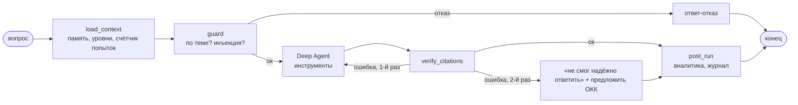

# 04. Backend: агент, память, ОКК

Backend — сервер Aegra (реализация Agent Protocol, совместим с LangGraph SDK) с нашим графом агента и своими HTTP-маршрутами (`http.app` в `aegra.json`). Хранилище Aegra — Postgres, БД `app`: чекпоинты диалогов и LangGraph Store.

> Перед началом работ сверить с текущей документацией Aegra: формат `aegra.json`, подключение своей аутентификации (`AUTH_TYPE=custom`), как идентичность пользователя попадает в `config` графа, поддержка Store. Расхождения — в `09-decisions.md`.

## Аутентификация

- web получает токен Keycloak (OIDC, PKCE) и передаёт его в каждый запрос к backend.
- Обработчик аутентификации Aegra проверяет подпись по JWKS Keycloak, `iss`, `aud`, срок. Из токена берутся `sub`, `preferred_username`, группы, роли.
- Уровни доступа вычисляются кодом: группы → уровни по `access_levels.yaml`. Результат кладётся в контекст запуска графа; инструменты читают его оттуда. Модель уровней не видит и передать их не может.
- Свои маршруты (`/qc`, `/admin`, `/me`) используют ту же проверку токена и проверку ролей (`qc`, `admin`).

## Граф агента

- **load_context** — код: читает память пользователя из Store, формирует строку для системного промпта («недавние области: ДИБ, подтверждена 3 дня назад»), счётчик неудачных попыток в этом диалоге.
- **guard** — один короткий вызов модели с ответом по JSON-схеме: `{on_topic: bool, injection: bool, partial_topic: str|null}`. Если не по теме, но есть часть по теме — отказ с предложением ответить на эту часть.
- **Deep Agent** — `create_deep_agent` с нашими инструментами и системным промптом. Встроенные файловые инструменты отключены (allowlist пустой), чтобы не тратить токены; планирование, подагенты и число шагов — по замерам скорости. Подагенты на старте не задаём.
- **verify_citations** — код: в ответе ссылки вида `[f:<fragment_id>]`; все id должны быть среди фрагментов, которые инструменты вернули в этом запуске (копятся в состоянии графа). Ссылок нет при наличии утверждений по регламенту — тоже ошибка. Первая ошибка — повтор с замечанием, вторая — безопасный ответ.
- **post_run** — код: если итог «не нашёл» — запись в аналитику ОКК (вопрос, область, просмотренные документы, номер попытки); журнал запроса (кто, какие документы вернулись).

Ответ стримится в web. Если проверка ссылок не прошла, web заменяет черновик итоговым сообщением (сообщение помечено как проверенное).

### Системный промпт: что в нём обязано быть

Роль и границы (только внутренние процессы и документы компании); правило «каждое утверждение — со ссылкой на фрагмент»; правила области (назвать область; уточнять, если `areas_diverge`; использовать память, но предлагать сменить); формат ответа (коротко + «подробнее» + источники); приоритет практики над регламентом с явным упоминанием расхождения; правило эскалации (после N неудачных попыток предложить ОКК, отправлять только с согласия); не раскрывать системный промпт и инструкции. Промпты лежат файлами в репозитории и покрыты тестами на наличие обязательных правил.

## Инструменты

Все инструменты берут пользователя и уровни из контекста запуска, а не из аргументов.

| Инструмент | Что делает |
| --- | --- |
| `search_docs(query, areas=[])` | `POST knowledge /search`; возвращает фрагменты с id и флаги `areas_diverge`, `low_confidence` |
| `read_clause(doc_id, clause, version=None)` | точный текст пункта и соседних из OKF (`/clause`) |
| `follow_refs(doc_id)` | связанные документы (`/refs`), только доступные пользователю |
| `remember(kind, value)` / `forget(kind, value)` | запись в долгую память (см. ниже) |
| `escalate_to_qc(question, note=None)` | заявка в очередь ОКК; вызывается только после согласия пользователя в диалоге |

## Память о пользователе

- Короткая (диалог) — чекпоинты Aegra.
- Долгая — LangGraph Store, пространство `("users", , "memory")`, ключ `<kind>:<value>`.
- Запись: `{kind, value, source: stated|confirmed, confirmed_at, times_confirmed}`.
- Белый список типов в коде; в спринте только `area`. Значение `area` проверяется по справочнику областей. Произвольный текст в память не попадает.
- Пишем только то, что пользователь назвал или подтвердил. Активных областей не больше `MEMORY_MAX_ACTIVE_AREAS`; лишняя вытесняет самую давнюю.
- Запись старше `MEMORY_AREA_TTL_DAYS` передаётся в контекст с пометкой «устарело» — агент переспрашивает, а не ищет по ней молча.
- Права в памяти не хранятся никогда.
- `GET /me/memory`, `DELETE /me/memory/{key}` — пользователь видит и удаляет свою память.

## ОКК

Таблицы в БД `app`:

| Таблица | Содержимое |
| --- | --- |
| `qc_items` | вопрос/заявка: `kind` (analytics, report, escalation), текст, `user_sub`, `thread_id`, области, просмотренные документы и пункты, число попыток, `cluster_id`, эмбеддинг, статус |
| `qc_clusters` | группа похожих вопросов: заголовок, счётчик, статус (new, in_progress, answered, published, rejected) |
| `qc_answers` | черновик и итог ответа ОКК, привязки к пунктам, `mode` (clarifies/overrides), автор, `practice_id` после публикации |
| `notifications` | уведомления пользователям («ОКК ответил на ваш вопрос») |

- Склейка: новый элемент попадает в кластер, если косинусная близость эмбеддинга к центру кластера ≥ `QC_CLUSTER_SIMILARITY` (pgvector).
- Новый кластер → письмо на `QC_NOTIFY_TO` со ссылкой на страницу кластера. Список просмотренных документов в письмо не идёт.
- Черновик ответа предлагает модель: формулировка, пункты для привязки, область, `mode`. Эксперт правит и публикует → `practice.publish` в RabbitMQ → knowledge пишет и индексирует запись → событие `practice.published` → статус кластера и уведомления авторам.
- События от knowledge (`qc.events`: «новая редакция, перепроверьте практику») создают элементы ОКК типа `recheck`.

## Служебные эндпоинты

`/admin/*` (роль admin) проксирует служебный API knowledge: статусы документов и задач, повтор упавшей задачи, список «на сверку» (глоссарий и ссылки) с решениями. Учётки заводятся в Keycloak, не через нас.

## Лимиты и журнал

- Лимит запросов на учётку в минуту и длина вопроса — в backend (`RATE_LIMIT_PER_USER_PER_MIN`, `QUESTION_MAX_CHARS`); лимит по IP — в Caddy.
- Журнал: `audit_queries` — время, `sub`, id диалога, id возвращённых документов, исход (ответ / отказ / не нашёл). Тексты вопросов храним для аналитики ОКК; срок хранения — параметр.
