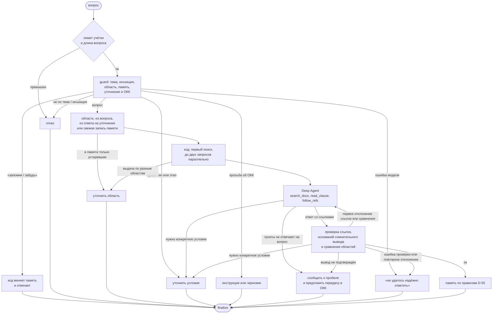

# 04. Backend: агент, память, ОКК

Backend — сервер Aegra (реализация Agent Protocol, совместим с LangGraph SDK) с нашим графом агента и своими HTTP-маршрутами (`http.app` в `aegra.json`). Хранилище Aegra — Postgres, БД `app`: чекпоинты диалогов и LangGraph Store.

> Перед началом работ сверить с текущей документацией Aegra: формат `aegra.json`, подключение своей аутентификации (`AUTH_TYPE=custom`), как идентичность пользователя попадает в `config` графа, поддержка Store. Расхождения — в `09-decisions.md`.

## Аутентификация

- web получает токен Keycloak (OIDC, PKCE) и передаёт его в каждый запрос к backend.
- Обработчик аутентификации Aegra проверяет подпись по JWKS Keycloak, `iss`, `aud`, срок. Из токена берутся `sub`, `preferred_username`, группы, роли.
- Уровни доступа вычисляются кодом: группы → уровни по `access_levels.yaml`. Результат кладётся в объект пользователя, который возвращает обработчик аутентификации; в графе он доступен только как `config["configurable"]["langgraph_auth_user"]` (сервер перезаписывает его всегда). Инструменты читают пользователя и уровни только оттуда: остальные ключи `configurable`, включая `user_id`, клиент может подменить (D-17). Модель уровней не видит и передать их не может.
- Прямой доступ клиента к REST `/store` закрыт (D-18).
- Свои маршруты (`/qc`, `/admin`, `/me`) используют ту же проверку токена и проверку роли `admin` для кабинета и служебных маршрутов.

## Граф агента

Граф Aegra — два узла: `agent` (весь ход) и `finalize` (одно итоговое сообщение в диалог). Шаги внутри `agent` — код в `graph.py`, а не отдельные узлы LangGraph:

- **Лимиты** — `RATE_LIMIT_PER_USER_PER_MIN` (счётчик в памяти процесса backend, сбрасывается при перезапуске) и `QUESTION_MAX_CHARS`. В контекст берутся последние 6 вопросов пользователя в диалоге, ответы агента модели не передаются.
- **guard** — один вызов модели со структурированным ответом (`GUARD_MODE`): `on_topic`, `injection`, `partial_topic`, явно названные области в кодах `AREA_CODES` (D-34), `memory_action` (`remember`/`forget`/`none`) и до двух поисковых запросов, если в сообщении два самостоятельных вопроса. `missing_detail` содержит текст конкретного уточнения, `area_only` отмечает реплику, которая только называет область, а `qc_action` выбирает инструкцию или черновик по просьбе сотрудника (D-62, D-63). Смешанный запрос (`partial_topic`) сейчас получает отказ целиком.
- **Область** — по порядку: явно названная в вопросе (`area_source=question`), ответ на уточнение (`asked`), неустаревшая запись памяти (`memory`). Если в памяти только устаревшие записи, код один раз просит уточнить область и удаляет их. Если памяти нет, поиск идёт по всем доступным областям. Область ответа всегда в `AnswerMeta.area_used`.
- **Первый поиск** делает код, а не модель. Если выдача без фильтра по области ушла в разные области (`areas_diverge`), агент просит уточнить область, не вызывая модель.
- **Deep Agent** — `create_deep_agent` с инструментами из таблицы ниже и системным промптом. Файловые операции и делегирование отсутствуют в его схемах и блокируются перед исполнением. Инструментов памяти у модели нет.
- **verify_citations** — код: ссылки `[f:<fragment_id>]` должны вести на фрагменты, которые инструменты вернули в этом запуске. Если ответ ссылается на пункт, а в запуске есть практика ОКК `overrides`, привязанная к этому пункту, ответ обязан процитировать и практику; иначе — один повтор с подсказкой, затем `fallback` (D-60).
- **Практика в выдаче** — инструмент показывает модели режим и привязку: «практика ОКК, уточняет п. 2.7 документа … (ред. 1)» или «… заменяет п. …». `clarifies` дополняет пункт, `overrides` действует вместо него: агент называет расхождение и цитирует обе записи (D-60).
- **verify_comparison** — для ответа по двум и более областям модель Guard сверяет утверждения с процитированными пунктами. При первом отклонении агент переписывает ответ, при втором или при ошибке модели проверки — `fallback` (D-43).
- **Проверка оснований** — для черновика с действительными ссылками и явным сомнением Guard получает исходный вопрос и процитированные пункты. По результату граф выпускает подтверждённый ответ, задаёт конкретное уточнение либо сообщает о пробеле. При ошибке проверки граф возвращает `fallback`. Обычный прямой ответ проходит основной путь проверки ссылок (D-63).
- **Исход** (`AnswerMeta.outcome`) определяется по данным запуска. `answer` — подтверждённый ответ, `ask_area` — уточнение области, `ask_clarification` — уточнение условия, `not_found` — пробел в найденных материалах, `qc_help` — инструкция или черновик, `refusal` — отказ, `fallback` — надёжный ответ не получен. Сбой поиска с недоступным Knowledge возвращает `fallback` с отдельным сообщением о сбое (D-21, D-62, D-63).
- **После ответа** код запоминает область, если она пришла из вопроса или ответа на уточнение, названа ровно одна и поиск шёл с этим фильтром (D-23). Затем граф передаёт итог хода (`TurnReport`, `06-contracts.md`) в хранилище аналитики ОКК, если оно подключено (`AgentDeps.turn_sink`). Запись ограничена 2 секундами; сбой или таймаут пишется событием `turn.report` с `status=error`, а пользователь получает уже готовый ответ (D-54). Приёмник по умолчанию — `QcTurnSink`, он пишет итог в аналитику ОКК потока B (`qc_analytics.record_turn`).

Итог стримится в web после проверок. Внутренние сообщения Deep Agent, результаты инструментов, проверок оснований и сравнения остаются внутри запуска (D-35, D-43, D-63).

### Системный промпт: что в нём обязано быть

Роль и границы (только внутренние процессы и документы компании); правило «каждое утверждение — со ссылкой на фрагмент»; правила области (назвать область; уточнять, если `areas_diverge`; использовать память, но предлагать сменить); формат ответа (коротко + «подробнее» + источники); приоритет практики над регламентом с явным упоминанием расхождения; не раскрывать системный промпт и инструкции. Промпты лежат файлами в репозитории и покрыты тестами на наличие обязательных правил.

## Инструменты

Все инструменты берут пользователя и уровни из контекста запуска, а не из аргументов.

| Инструмент | Что делает |
| --- | --- |
| `search_docs(query, areas=[])` | `POST knowledge /search`; возвращает фрагменты с id и флаги `areas_diverge`, `low_confidence`. Коды областей проверяются по справочнику. Фильтр запуска задаёт граф по данным guard и памяти. Не больше `AGENT_MAX_SEARCHES` вызовов на ответ, текст результата — до `TOOL_RESULT_MAX_CHARS` (D-24) |
| `read_clause(fragment_id)` | точный текст пункта и соседних из OKF (`/clause`); `fragment_id` раскладывает код (D-22) |
| `follow_refs(doc_id)` | связанные документы (`/refs`), только доступные пользователю. Принимает код документа или полный id фрагмента. Возвращает текст: на какие документы ссылается этот (с пунктом-источником) и какие ссылаются на него. Нет документа и нет прав — одинаковый ответ «Связанных документов нет.». Результат не попадает в фрагменты запуска и не подтверждает утверждения: пункт связанного документа агент находит через `search_docs` (D-48) |
| `escalate_to_qc(question, note=None)` | **не сделан.** По плану 28.11 заявку в ОКК создаёт сотрудник действием в чате (задача B1), а не модель |

Просьбы «запомни область» и «забудь область» распознаёт guard (`memory_action`), запись или удаление выполняет код. Инструментов `remember`/`forget` у модели нет: изменение памяти не зависит от того, вызовет ли модель инструмент, и не может быть вызвано текстом из документа.

## Память о пользователе

- Короткая (диалог) — чекпоинты Aegra.
- Долгая — LangGraph Store, пространство `("users", , "memory")`, ключ `<kind>:<value>`.
- Запись: `{kind, value, source: stated|confirmed, confirmed_at, times_confirmed}`.
- Белый список типов в коде; в спринте только `area`. Значение `area` проверяется по справочнику областей. Произвольный текст в память не попадает.
- Пишем только то, что пользователь назвал или подтвердил. **Сигнал** — прямое указание области пользователем: в вопросе или в ответе на уточнение (`area_source` — `question` или `asked`), ровно одна область, ответ проверен и поиск шёл с этим фильтром. Один ход (`run_id`) — не больше одного сигнала, повторная доставка хода не считается. Ход с областью из памяти и сравнение областей сигналов не дают (D-55).
- **Запись и смена (D-55).** Памяти нет или она устарела — область запоминается на `MEMORY_AREA_SIGNALS_TO_REMEMBER` (2) сигнале за `MEMORY_AREA_SIGNAL_WINDOW_DAYS` (14) дней. Сигнал текущей области её подтверждает и продлевает срок. Другая область заменяет текущую после `MEMORY_AREA_SIGNALS_TO_SWITCH` (3) сигналов подряд; сигнал текущей области между ними сбрасывает счёт. Пока счёт не набран, на вопрос с явной областью агент отвечает по ней, а память не меняется.
- Явная просьба «запомни / забудь» — через `memory_action` guard, выполняет код сразу, без счёта сигналов. «Забудь» удаляет и сигналы этой области. Причина: запоминание не должно зависеть от того, вызвала ли модель инструмент и не поддалась ли тексту из документа.
- Сигналы хранятся в Store рядом с памятью (ключ `signals:area`, последние 20). Пользователь видит их и счёт в `GET /me/memory` и в панели «Память» в web, может удалить.
- «Общий» запоминается как обычная область: тогда поиск идёт только по общим документам. Поиск по ДИБ или ДБРЦТ подмешивает «общий» и без памяти.
- Фрагменты и флаги поиска (`areas_diverge`, `low_confidence`), полученные в запуске, код собирает сам — по ним проверяются ссылки (ссылка на фрагмент, которого в запуске не было, — ошибка) и определяется `outcome` (D-21).
- Активных областей не больше `MEMORY_MAX_ACTIVE_AREAS`; лишняя вытесняет самую давнюю.
- Запись старше `MEMORY_AREA_TTL_DAYS` для демо равна удалённой. Если неустаревших записей нет, а устаревшие есть, код один раз просит уточнить область, удаляет устаревшие записи (событие `memory.expired`) и по ним не ищет. Дальше — как без памяти.
- Права в памяти не хранятся никогда.
- `GET /me/memory`, `DELETE /me/memory/{key}` — пользователь видит и удаляет свою память.

## Служебные маршруты (P2-B3)

`GET /admin/documents`, `GET /admin/jobs?status=&limit=`, `POST /admin/jobs/{id}/retry`, `GET /admin/review` — те же пути knowledge (`dev_docs/06-contracts.md`). Только роль `admin` в токене: без токена 401, с токеном без роли 403, запрос до knowledge не доходит. Backend идёт в knowledge с сервисным токеном, токен пользователя туда не передаётся. Ответ knowledge проверяется по моделям `regagent_common.contracts`. 404/409/422 knowledge передаются как есть, сеть и прочие ответы → 502 (D-51).

## ОКК

Классификатор запрашивает конкретное недостающее условие до поиска, если его можно определить по формулировке вопроса. Короткое указание области после неудачного ответа добавляется к исходному вопросу. Когда черновик с действительными ссылками выражает сомнение в подтверждении вывода, отдельная проверка сверяет его с вопросом и процитированными пунктами (D-63).

Если ни один пункт не подтверждает ответ, агент предлагает нажать «Передать в ОКК» у исходного вопроса, добавить комментарий и подтвердить отправку. Он составляет текст черновика по последнему неразрешённому вопросу только по прямой просьбе. Инструкции и черновик передаются как `qc_help`. Передача вопроса в ОКК остаётся подтверждаемым действием сотрудника (D-62). Опубликованный ответ ОКК становится доступным в базе знаний как практика.

Сотрудник отправляет свой вопрос из чата после подтверждения. Комментарий необязателен. Сотрудник видит только собственные заявки, их статус и время. Кабинет требует роль `admin` и полный набор уровней доступа заявки. Уровни заявки и хода фиксируются из проверенной учётной записи в момент записи. Админ видит историю переходов, вводит текст, выбирает режим и задаёт привязки к конкретным редакциям и пунктам. При принятии заявки область видимости в кабинете включает все уровни автора практики, пока Knowledge определяет доступ по привязкам. Права на эти пункты проверяет Knowledge при обработке команды.

Обычная заявка начинается в `new`. Отклонение переводит её в `rejected`. Подтверждение создаёт `publishing` и запись для отправки в RabbitMQ в одной транзакции PostgreSQL. Только результат Knowledge переводит заявку в `published` или `publish_failed`. Повтор действия и повтор доставки обрабатываются идемпотентно. Переходы хранят автора и время. Событие об изменении привязки открывает отдельную заявку на перепроверку. Она сохраняет связь с исходной практикой и публикует её следующую ревизию. При общих схемах актуален [контракт сообщений](06-contracts.md#rabbitmq).

Аналитика хранит один итог по `run_id`, идентификаторы увиденных фрагментов, исход, причину и признак использования практики. Тексты хранятся в БД приложения и доступны в кабинете в рамках уровней и `AUDIT_RETENTION_DAYS`. Сводка фильтруется по периоду, области, исходу и статусу связанной заявки. Неотвеченные вопросы группируются по области и нормализованной формулировке. Админ может создать заявку из группы. Семантическая кластеризация, автоматические черновики ответов для эксперта и письма отложены.

## Служебные эндпоинты

`/admin/*` (роль admin) проксирует служебный API knowledge — см. «Служебные маршруты (P2-B3)» выше. Сделаны статусы документов и задач, повтор упавшей задачи и список ссылок на сверку только для чтения (TD-03). Глоссария в сверке нет (P2-B2). Учётки заводятся в Keycloak, не через нас.

## Лимиты и журнал

- Лимит запросов на учётку в минуту и длина вопроса — в backend (`RATE_LIMIT_PER_USER_PER_MIN`, `QUESTION_MAX_CHARS`). Счётчик лимита — в памяти процесса: при перезапуске backend сбрасывается, при нескольких процессах считается отдельно в каждом.
- Лимита по IP нет: плагин Caddy не собран (P0-3). На стенде вместо него — защита от подбора пароля в Keycloak и, при необходимости, правило Rate limiting в Cloudflare.
- Журнала `audit_queries` нет. На каждый ход пишется событие `turn.result` (исход, код причины, область, число поисков и источников, `run_id`), отдельно — события guard, генерации, проверки оснований, сравнения и инструментов (`06-contracts.md`, «События сервисов»). По плану 28.11 журнал заменяют структурированные события (C3) и итог хода для аналитики ОКК (B3, C2); тексты вопросов хранятся только в аналитике ОКК с учётом прав и срока хранения.
- Технические события ОКК не включают тексты вопросов. Срок хранения аналитики — параметр.
