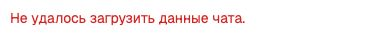

# Ручной прогон демо RegAgent — 27 ноября 2026

- Первичная проверка доступа — 20:21. Проверка после входа — 20:31. Повтор после исправления — 20:54. Время Барнаула (UTC+7).
- Стенд — [RegAgent](https://regagent.honey-road.tech/).
- Учётки для сценариев — `employee_public`, `employee_fin` из realm `regagent` (в первой версии записи ошибочно названы `tester_*`, таких учёток нет). Под какой учёткой шёл контрольный вход в 20:54 — не записано.
- SHA выложенного релиза — не подтверждён.

## Повтор после исправления

После обновления страницы и входа загрузились список диалогов и поле ввода. Кнопка «Новый диалог» открыла пустой чат. После нового обновления страницы и входа контрольный диалог сохранился в списке. При повторном открытии восстановились и вопрос, и ответ с источниками.

| Вопрос | Фактический ответ | Время наблюдения |
| --- | --- | --- |
| Кто формирует запрос на подбор субподрядчика, если внутренних ресурсов не хватает? | «Уточните, для какой области нужен порядок по регламенту». В кейсе `subcontract-initiator` ожидается прямой ответ с п. 1.1. | Ответ виден не позднее чем через 9,4 с. |
| Сравните общую область и ДИБ. Кто по регламенту подбора субподрядчика формирует запрос, если внутренних ресурсов не хватает? | Агент назвал РП для общего порядка и пресейл-архитектора для ДИБ. В карточках есть «Регламент подбора субподрядчика», п. 1.1, ред. 1, и «Пресейловая деятельность Дирекции ИБ», п. 6, ред. 1. В том же ответе агент утверждает, что по общему порядку отдельный запрос от РП не требуется. | Ответ виден не позднее чем через 11,6 с. |

В обоих случаях при отправке был виден статус «Ищу в регламентах…». Время до первых слов отдельно не измерялось. Блок «Подробнее» открылся и закрылся, ссылка `[1]` перенесла к карточке источника с п. 1.1.

## История проверки доступа

В чистой сессии браузер показал форму **Log in to regagent** от Cloudflare Access. Анонимные запросы к `/`, `/api/health` и OIDC discovery вернули HTTP 302 на `honey-road.cloudflareaccess.com`. После прохождения Cloudflare Access открылся RegAgent с кнопкой «Выйти», но вместо поля ввода отображалось **«Не удалось загрузить данные чата.»** Ошибка повторилась после обновления страницы и нажатия «Войти». Нажатие «Новый диалог» поле ввода не открыло.

В той же браузерной сессии `/api/health` вернул `status: healthy`. Поля `database`, `langgraph_checkpointer` и `langgraph_store` имели значение `connected`.

| Проверка | Статус | Факт |
| --- | --- | --- |
| Вход | Частично | Cloudflare Access пройден, авторизованный чат открылся. Вход под обеими тестовыми учётками предстоит проверить. |
| 1. Уточнение и память | Не проверено | Нужен `employee_public` с чистой памятью для сценария про РП. |
| 2. Два документа | Частично | Контрольный ответ показал ссылки на несколько документов. Запланированные вопросы под `employee_public` ещё не проверены. |
| 4. Отказы | Не проверено | Нужен прогон под обеими тестовыми учётками. |
| 7. Редакция | Не проверено | Для замера нужна согласованная подмена редакции владельцем стенда. Сценарий покрыт [`test_switching_manifest_revision_changes_the_answer`](../tests/e2e/test_mvp_scenarios.py). |
| 8. Разграничение доступа | Не проверено | Нужен вход под обеими тестовыми учётками. |
| Свободные вопросы и интерфейс | Частично | Подтверждены отправка, отображение ответа с источниками, переход по ссылке, раскрытие «Подробнее» и сохранение диалога после перезагрузки. |

Вопросы и ожидаемые результаты собраны в [чек-листе](demo-checklist.md). [Кейс автоматического прогона](../eval/questions.yaml)

## Найдено при подготовке

| Проверка | Ожидалось | Получилось | Владелец |
| --- | --- | --- | --- |
| Загрузка чата после входа | Открывается поле для вопроса, кнопка «Новый диалог» позволяет начать разговор. | В 20:31 отображалась ошибка загрузки. При повторе в 20:54 чат, отправка и открытие сохранённого диалога сработали. | Закрыто повторной проверкой. |
| Содержание ответа о субподрядчике | П. 1.1 определяет, кто формирует запрос. Правила выбора кандидатов и принятия решения о субподряде относятся к другим действиям. | В одном ответе сказано, что запрос формирует РП и что отдельный запрос от РП не требуется. П. 2.10 и 9.6 общего регламента описывают критерии выбора и решение о субподряде. Утверждение об отсутствии запроса из этих пунктов не следует. | Backend. Предполагаемая причина — объединение разных действий при формировании ответа. |
| Вход на стенд из чистой сессии | Доступ к форме Keycloak для демо-учёток согласно инструкции выкладки. | Перед Keycloak действует Cloudflare Access. Для сценария заказчика нужно подтвердить, какой вход предусмотрен и кто имеет доступ. | Выкатка |

Для дефекта сравнения подготовлена проверка утверждений по процитированным пунктам. Подтверждение на живой модели предстоит после выкладки. [Решение D-43](09-decisions.md)
