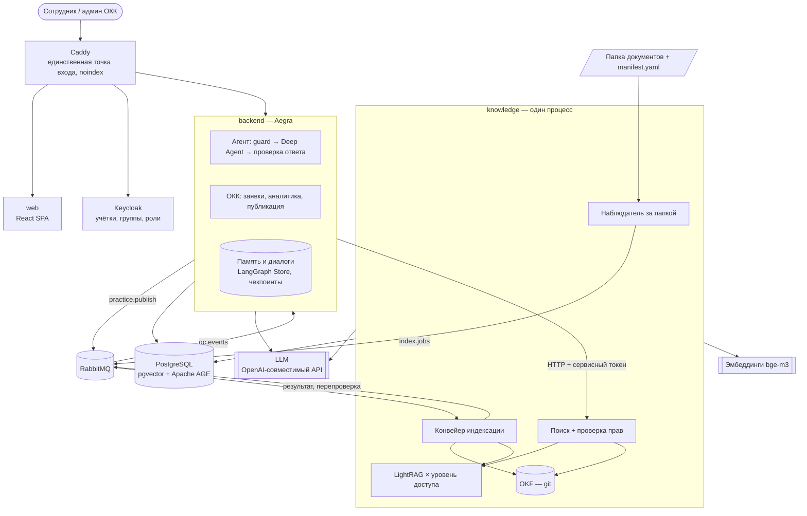
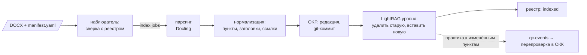
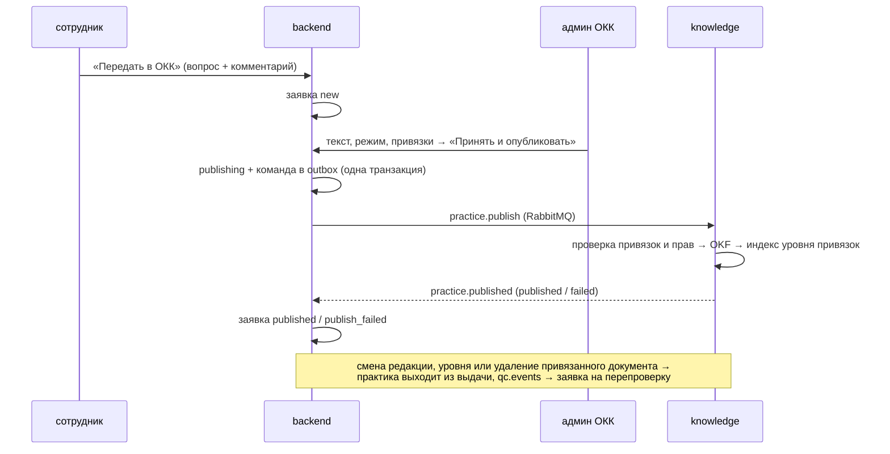
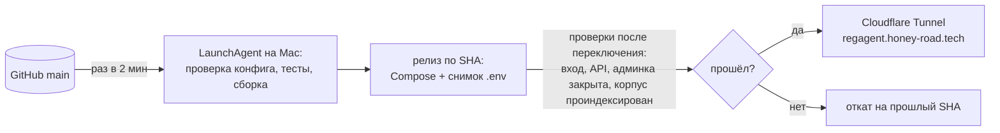

# RegAgent — HLD

Архитектура верхнего уровня: какие задачи решает система, из каких частей состоит и как проходят основные потоки. Устройство модулей, контракты и параметры описаны в [LLD](LLD.md). Обзор, запуск и учётки — в [README](../README.md).

## Содержание

1. [Задача и требования](#1-задача-и-требования)
2. [Компоненты](#2-компоненты)
3. [Путь вопроса](#3-путь-вопроса)
4. [Индексация документов](#4-индексация-документов)
5. [Контур ОКК и практика](#5-контур-окк-и-практика)
6. [Разграничение доступа](#6-разграничение-доступа)
7. [Область и память](#7-область-и-память)
8. [Наблюдаемость](#8-наблюдаемость)
9. [Развёртывание](#9-развёртывание)
10. [Ключевые решения](#10-ключевые-решения)

## 1. Задача и требования

| Требование | Как обеспечено |
| --- | --- |
| Каждое утверждение ответа опирается на пункт регламента | Фрагмент = пункт с заголовком. Ссылки `[f:<id>]` проверяет код по фрагментам текущего запуска |
| Ответы по нескольким связанным документам | LightRAG в режиме `mix` (граф сущностей + векторы), связи документов по названиям в OKF |
| Порядок в разных подразделениях разный | Фильтр области в поиске, флаг расхождения областей, уточнение у пользователя, память об области |
| Практика ОКК дополняет или заменяет регламент | Практика индексируется как фрагмент с режимом и привязками, правила её цитирования проверяет код |
| Закрытые документы не видны посторонним | Права определяет только код. Отдельный индекс на уровень, повторная проверка каждого фрагмента, канарейки |
| Корпус меняется | Наблюдатель за папкой, очередь индексации, замена редакции в индексе, перепроверка практики |
| Неподтверждённый ответ хуже, чем «не нашёл» | Ответ, не прошедший проверку, заменяется честным отказом и предложением передать вопрос в ОКК |
| Отказы на вопросы не по теме и на взлом промпта | Классификатор до поиска. Права не зависят от модели |

## 2. Компоненты



| Компонент | Ответственность |
| --- | --- |
| `proxy` (Caddy) | Маршрутизация на web, backend и Keycloak, `X-Robots-Tag: noindex` и `robots.txt`. Отвечает 404 на консоль Keycloak и realm `master`. TLS на стенде даёт Cloudflare Tunnel |
| `keycloak` | Именные учётки, группы уровней доступа, роль `admin`, OIDC с PKCE. Саморегистрации нет |
| `web` | Чат с источниками, панель «Память», «Мои заявки», кабинет и аналитика ОКК |
| `backend` | Сервер Aegra с графом агента и своими маршрутами: память, ОКК, служебный прокси. Проверка токена, лимиты |
| `knowledge` | Манифест и реестр документов, парсинг, нормализация по пунктам, OKF, индексация в LightRAG, поиск с проверкой прав, публикация практики, служебный API |
| `rabbitmq` | Очереди индексации, команд публикации практики и событий ОКК, очереди ошибок |
| `postgres` | БД `knowledge` (хранилища LightRAG, реестр), `app` (диалоги, память, ОКК, аналитика), `keycloak` |

**Почему knowledge — один процесс.** LightRAG координирует хранилища и конвейер через общую память процесса и не поддерживает нескольких писателей в одно рабочее пространство. Единственный писатель в OKF — тоже knowledge.

**Почему RabbitMQ.** Задачи приходят из двух мест: наблюдатель и ОКК. Они должны переживать перезапуск, повторяться при сбоях и уходить в очередь ошибок.

## 3. Путь вопроса

```mermaid
sequenceDiagram
  participant W as web
  participant B as backend
  participant K as knowledge
  participant L as LLM
  W->>B: вопрос (JWT Keycloak)
  B->>B: токен → пользователь и уровни доступа; лимиты
  B->>L: guard: тема, инъекция, область, память, уточнение
  alt не по теме / инъекция
    B-->>W: отказ
  else вопрос по регламентам
    B->>B: область: вопрос → ответ на уточнение → память
    B->>K: первый поиск (код)
    loop Deep Agent
      B->>K: search_docs / read_clause / follow_refs (уровни из токена)
      K-->>B: фрагменты с проверенными правами
    end
    B->>B: проверка ссылок и практики (код)
    opt сравнение областей или сомнительный вывод
      B->>L: сверка утверждений с процитированными пунктами
    end
    B-->>W: ответ + область + источники
    B->>B: память об области, итог хода в аналитику ОКК
  end
```

| Решение | Кто принимает |
| --- | --- |
| Тема, инъекция, явная область, просьба «запомни / забудь», нужно ли уточнить условие | модель (классификатор со структурированным ответом), исполняет код |
| Уровни доступа, фильтр области, первый поиск, запись памяти | код |
| Что ещё искать и читать, текст ответа | модель (Deep Agent) |
| Ссылки ведут на полученные фрагменты, процитирована заменяющая практика | код |
| Утверждения сравнения областей и сомнительного вывода подтверждаются пунктами | модель-проверяющий, по её вердикту действует код |
| Итог хода: ответ, уточнение, «не нашёл», отказ, технический сбой | код по данным запуска |

Ответ, не прошедший проверку, переписывается один раз. Повторный отказ проверки даёт «не удалось надёжно ответить». Если найденные пункты не отвечают на вопрос, агент сообщает о пробеле и предлагает передать вопрос в ОКК. Пользователь видит только проверенный итог: черновики, вызовы инструментов и результаты проверок остаются внутри запуска.

## 4. Индексация документов



- **Запрет по умолчанию.** Документ без записи в манифесте или с неизвестным уровнем не индексируется.
- **Фрагменты режет код по пунктам, а не LightRAG.** Каждый фрагмент начинается заголовком `⟦doc=… v=… clause=… area=… level=…⟧`.
- **Ссылки на другие регламенты по названию** сопоставляются с манифестом через лемматизацию и пишутся в OKF. Неоднозначные и ненайденные попадают в список на сверку.
- **Надёжность.** Задачи идемпотентны по документу, редакции и хэшу. Ограничены тайм-аутом, повторяются до 3 раз, затем уходят в очередь ошибок. При старте knowledge убирает недоделанные вставки и возвращает прерванные задачи в повтор.

## 5. Контур ОКК и практика



- **Режимы практики.** `clarifies` дополняет пункт. `overrides` действует вместо него, и ответ обязан процитировать практику.
- **Аналитика ОКК.** На каждый ход сохраняется итог: исход, область, увиденные фрагменты, использована ли практика. Неотвеченные вопросы группируются по области и нормализованной формулировке, из группы создаётся заявка. Тексты вопросов хранятся только здесь, ограниченный срок, с учётом прав.
- **Идемпотентность.** Двойной клик даёт одну заявку. Повтор команды, результата и события перепроверки безопасен. Статус `published` появляется только после подтверждения knowledge.

## 6. Разграничение доступа

Права определяет и проверяет только код. Модель уровней не видит и передать их не может. Защита многослойная:

1. **Запрет по умолчанию** в манифесте.
2. **Физическое разделение.** Своё рабочее пространство LightRAG (таблицы и граф AGE) на каждый уровень. Поиск идёт только по уровням пользователя.
3. **Личность только из токена.** Backend проверяет подпись, издателя, аудиторию и срок, уровни вычисляет из групп. Инструменты агента не имеют аргументов уровня или пользователя.
4. **Повторная проверка каждого фрагмента** в knowledge по реестру. Фрагмент без разбираемого заголовка или с расхождением уровня отбрасывается.
5. **Практика** получает уровень своих привязок. Кабинет ОКК показывает заявки только в пределах прав администратора.
6. **Пустое служебное пространство по умолчанию и канарейки.** Любой путь, ошибочно упавший на пространство по умолчанию, ничего не найдёт. В каждом закрытом уровне лежит документ-маркер, и при старте knowledge и в тестах проверяется, что его не видно с других уровней.
7. **Ответы API.** Отсутствие прав и отсутствие документа дают одинаковый результат при прочих равных. Если запрос явно называет закрытый документ, Knowledge может отметить это в служебном журнале без названия, кода или текста документа.
8. **Сеть.** Наружу открыт только Caddy. Knowledge требует сервисный токен, консоль Keycloak снаружи недоступна. Прямой доступ клиента к Store Aegra закрыт.
9. **Журналы.** В событиях нет текстов вопросов, ответов, промптов, паролей и токенов.

## 7. Область и память

- **Источник области** по порядку: явно названная в вопросе, ответ на уточнение, область предыдущего ответа для связанного продолжения, свежая запись памяти. Без области поиск идёт по всем доступным областям. Если выдача расходится по областям, агент уточняет.
- **Диалог.** Агент отвечает на последнюю реплику. Предыдущие вопросы помогают разобрать уточнение или продолжение. Новый вопрос запускает свой поиск даже после предложения передать предыдущий в ОКК.
- **Что считается сигналом.** Только прямое указание пользователя: одна область в вопросе или в ответе на уточнение, ответ проверен. Один ход — не больше одного сигнала.
- **Запись и смена.** Первая область запоминается после 2 сигналов за 14 дней, смена — после 3 сигналов подряд за другую. Просьба «запомни» или «забудь» выполняется сразу. Устаревшая запись равна удалённой: агент один раз переспрашивает.
- **Хранение.** Память — в LangGraph Store под `sub` из токена. Права в ней не хранятся. Пользователь видит её и сбрасывает в панели «Память».

## 8. Наблюдаемость

- **События.** Каждый сервис пишет технические события одной JSON-строкой в stdout: ход агента, классификация, генерация, проверки, поиск, индексация, память, публикация практики, выкатка. Поля: `service`, `event`, `status`, `duration_ms`, `error_code` и идентификаторы связи (`run_id`, `job_id`, `ticket_id`).
- **Учёт токенов** на каждый физический вызов модели и эмбеддингов, по операциям.
- **Мониторинг** — отдельный Compose: Alloy собирает логи контейнеров, Loki хранит 14 дней, Grafana показывает дашборд. Ходы по исходам, время, токены, ошибки, индексация, выкатка.

## 9. Развёртывание



- **Один Docker Compose.** LLM — внешний адрес. Эмбеддинги — Ollama на хосте или TEI в Compose. У knowledge и backend раздельные пользователи БД.
- **Общие данные релизов.** Корпус, OKF и тома БД общие для релизов, поэтому изменения схемы должны быть совместимы с предыдущей версией.
- **Мониторинг** — отдельный проект со своим туннелем, не зависит от релизов.

## 10. Ключевые решения

| Решение | Почему |
| --- | --- |
| LightRAG как библиотека, по объекту и рабочему пространству на уровень доступа. Сервер LightRAG не используется | Пространство изолирует данные в Postgres. В режиме сервера выбор пространства в запросах ненадёжен |
| Свои фрагменты по пунктам с заголовком, LightRAG текст не режет | Ссылки до пункта и проверка прав на каждом фрагменте |
| Поиск LightRAG без генерации ответа, реранк свой — после слияния уровней | Ответ формирует агент из проверяемых фрагментов, оценки сопоставимы между уровнями |
| OKF — git-хранилище редакций и практики | Точный текст пункта любой редакции, история изменений, один писатель |
| Связи документов — в OKF и через `/refs` с проверкой прав, не в графе LightRAG | Связь не должна раскрывать закрытый документ |
| Первый поиск и запись памяти делает код, а не модель | Поведение не зависит от того, вызовет ли модель инструмент. Текст документа не может изменить память |
| Проверка ссылок кодом, проверка выводов отдельным вызовом модели | Дешёвая детерминированная проверка на всё, дорогая — только на рискованные ответы |
| Публикация практики через outbox и RabbitMQ | Статус и команда фиксируются одной транзакцией, доставка переживает сбой брокера |
| Технические события в stdout без текстов | Достаточно сборщика логов, не нужны изменения кода, тексты не утекают в журналы |
