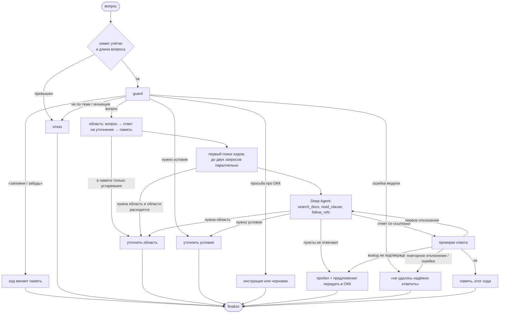
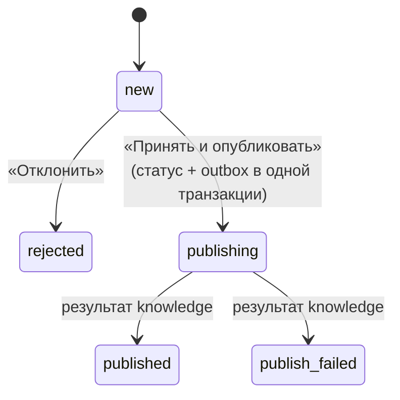

# RegAgent — LLD

Устройство сервисов, контракты, схемы данных и параметры. Архитектура верхнего уровня — в [HLD](HLD.md), запуск — в [README](../README.md), нереализованное — в [техдолге](TECH-DEBT.md). Номера `D-xx` в комментариях кода ссылаются на [приложение «Решения»](#14-решения).

## Содержание

1. [Общий пакет `regagent-common`](#1-общий-пакет-regagent-common)
2. [Knowledge](#2-knowledge)
3. [Backend: агент](#3-backend-агент)
4. [Backend: память](#4-backend-память)
5. [Backend: ОКК](#5-backend-окк)
6. [Web](#6-web)
7. [HTTP API](#7-http-api)
8. [RabbitMQ](#8-rabbitmq)
9. [Схемы данных](#9-схемы-данных)
10. [События](#10-события)
11. [Переменные окружения](#11-переменные-окружения)
12. [Безопасность](#12-безопасность)
13. [Тестирование](#13-тестирование)
14. [Решения](#14-решения)

## 1. Общий пакет `regagent-common`

`packages/common` импортируют оба сервиса. Изменение контракта сопровождается тестом.

| Модуль | Содержимое |
| --- | --- |
| `fragments` | Формат и разбор заголовка фрагмента, `fragment_id` |
| `access` | Загрузка `config/access_levels.yaml`, вычисление уровней из групп Keycloak |
| `contracts` | Pydantic-модели: поиск, пункт, связи, служебный API, `IndexJob`, практика (`PracticeBinding`, `PracticeSource`, `PracticePublish`, `PracticePublicationResult`, `PracticeRecheck`), `AnswerMeta`, `TurnReport` |
| `settings` | Общие настройки из `.env`: адреса и модели LLM и эмбеддингов, обязательны без значений по умолчанию (D-27) |
| `events` | `EventLog` — технические события одной JSON-строкой (D-52) |
| `broker` | Топология очередей, общих для двух сервисов, `declare_shared` (D-61) |

**Заголовок фрагмента.** Каждый фрагмент в индексе начинается строкой:

```
⟦doc=dib-project-activity v=1 clause=2.7 area=ДИБ level=public⟧ Проектная деятельность Дирекции ИБ — 2.7 …
```

По нему поиск восстанавливает метаданные и проверяет права. `fragment_id`:
- `<doc_id>@<version>#<clause>` — для пункта регламента;
- `practice:<practice_id>` — для практики. У практики `v=` в заголовке необязателен, поле `version` — `null` (D-25, TD-01).

**Уровни доступа** (`config/access_levels.yaml`). Документ принадлежит ровно одному уровню. Если документ должен быть доступен двум группам, заводится уровень с обеими группами.

```yaml
levels:
  public:     { groups: ["*"] }                 # любой вошедший
  closed_fin: { groups: ["/levels/closed_fin"] }
```

## 2. Knowledge

Один процесс: HTTP API (FastAPI), наблюдатель за папкой, потребитель RabbitMQ, реестр объектов LightRAG. Снаружи недоступен, backend ходит к нему с сервисным токеном.

### 2.1. Модули

| Модуль | Ответственность |
| --- | --- |
| `manifest` | Чтение и валидация `manifest.yaml`, справочник областей |
| `registry` | Таблицы `documents` и `jobs`: что, какой редакции и с каким хэшем проиндексировано, статусы и шаги задач |
| `watcher` | `FolderSource`: наблюдение за папкой (watchdog), дебаунс, сверка с реестром, постановка `index.jobs` |
| `parsing` | DOCX → Markdown с нумерацией пунктов (Docling), интерфейс `Parser`. PDF отклоняется (TD-02) |
| `normalize` | Разбиение на пункты, заголовки фрагментов |
| `references` | Ссылки на другие документы по названию через лемматизацию (pymorphy3) |
| `okf` | Запись и чтение OKF, git-коммиты. Единственный писатель |
| `rag`, `lightrag_factory` | Объект LightRAG на уровень, функции модели и эмбеддингов с учётом токенов, вставка, удаление, запрос |
| `search`, `rerank` | Поиск по уровням, точные пункты, реранк, фильтр области, проверка прав |
| `practice` | Публикация практики, её актуальность и перепроверка |
| `pipeline`, `jobs`, `consumer` | Конвейер индексации, прогресс задач, обработчики `index.jobs` и `practice.publish`, повторы |
| `canary` | Документы-маркеры закрытых уровней и проверка при старте |
| `reindex` | CLI: `--all` и `--failed` |
| `api`, `main` | HTTP-маршруты, сборка зависимостей, восстановление после перезапуска |

### 2.2. Манифест

`manifest.yaml` лежит в корне папки документов. Без записи в манифесте документ не индексируется. Ошибка валидации не роняет конвейер: документ получает статус `invalid_manifest`.

```yaml
areas:
  - { code: ДИБ, title: Дирекция информационной безопасности, synonyms: [Дирекция ИБ] }
documents:
  - file: dib-project-activity.docx
    doc_id: dib-project-activity       # стабильный id, [a-z0-9-]
    title: Проектная деятельность Дирекции ИБ
    areas: [ДИБ]                       # «общий» — для всех областей
    access: public                     # уровень из access_levels.yaml
    version: 1
    effective_from: 2026-11-27
```

### 2.3. Конвейер индексации

Задача `index.jobs`: `{job_id, op: upsert|delete, doc_id, version, path, sha256, force}`. Задача идемпотентна по `(doc_id, version, sha256)`. Флаг `force` заставляет переиндексировать документ, даже если он уже проиндексирован.

1. **parse** — DOCX в Markdown, нумерация пунктов («2.1.3») сохраняется.
2. **normalize** — фрагмент равен пункту верхнего уровня с подпунктами. Длинный раздел режется по подпунктам, предел — `CHUNK_MAX_TOKENS`. Ссылки по названию сопоставляются с манифестом: однозначные пишутся в `links`, неоднозначные — в `links_needing_review`, ненайденные — в `missing_links`.
3. **okf** — редакция пишется в `okf/docs/<doc_id>/v<N>.md` (YAML-шапка и пункты) с коммитом. Предыдущая редакция получает `status: deprecated`.
4. **index** — в пространстве уровня документа удаляется прошлая редакция (`adelete_by_doc_id`) и вставляется новая. Фрагменты склеены служебным разделителем, LightRAG режет ровно по нему: `split_by_character_only=True`, `ids=<doc_id>@v<version>` (D-28).
5. **registry** — статус `indexed`, время шагов.

- **Ошибки и тайм-ауты.** Ошибка шага — до `INDEX_MAX_RETRIES` повторов, затем `regagent.dlq` и статус `failed` с текстом ошибки. Попытка ограничена `INDEX_JOB_TIMEOUT_S`: при отмене незавершённая вставка удаляется из того же пространства, прогресс виден в `jobs.steps` и `jobs.current_step` (D-44).
- **Удаление документа (`delete`)** — убирает документ из индекса, OKF ставит `status: deleted`.
- **Практика к изменённому документу.** При новой редакции, смене содержимого или уровня привязанный документ практики уходит в `review` и в `qc.events`.

**Восстановление при старте** — до запуска потребителя (D-50):
- из LightRAG каждого уровня удаляются документы не в `processed`;
- документы реестра переводятся из `indexing` в `failed`, задачи — в `retrying`. Документ, который раз за разом роняет процесс, уходит в DLQ, а не зацикливает перезапуски.

**Пересборка индекса** (D-45):

```bash
docker compose --env-file .env -f deploy/compose.yaml exec knowledge python -m regagent_knowledge.reindex --all     # все действующие
docker compose --env-file .env -f deploy/compose.yaml exec knowledge python -m regagent_knowledge.reindex --failed  # упавшие
```

### 2.4. OKF

```
okf/
  docs/<doc_id>/v<N>.md        # редакция: шапка + пункты
  practice/<practice_id>.md    # практика: текст, команда, привязки, статус pending|active|review
```

Шапка редакции:

```yaml
type: regulation
doc_id: dib-project-activity
version: 1
status: active                 # active | deprecated | deleted
areas: [ДИБ]
access: public
sources: [{file: dib-project-activity.docx, sha256: …}]
links: [{doc_id: subcontractor-selection, via: "регламентом подбора субподрядчика", clause: "2.4"}]
links_needing_review: [{clause: "2.5", via: "…", candidates: [doc-a, doc-b]}]
missing_links: [{clause: "4.4", via: "…"}]
```

Связи между документами живут только в OKF и отдаются через `/refs` с проверкой прав. В граф LightRAG они не добавляются (D-48).

### 2.5. LightRAG

- **Хранилища:** `PGKVStorage`, `PGVectorStorage`, `PGGraphStorage` (Apache AGE), `PGDocStatusStorage`.
- **Пространства.** На уровень — объект с `workspace=lvl_<level>`. Первым инициализируется пустой `lvl__sentinel` (D-12). Если задан `POSTGRES_WORKSPACE`, knowledge не стартует: переменная сводит все пространства в одно (D-30).
- **Подключение к БД** LightRAG берёт из `POSTGRES_*` процесса, knowledge выставляет их из `KNOWLEDGE_DB_*` (D-32). pgvector ≥ 0.8, рабочий каталог — на постоянном томе (D-33). Токенизатор tiktoken передаётся явно, словарь скачивается при сборке образа (D-31).
- **Извлечение.** Язык — `LIGHTRAG_LANGUAGE` (`Russian`). Текстовый формат вывода, JSON включается `LIGHTRAG_EXTRACTION_JSON` (D-46). Повторные проходы — `LIGHTRAG_EXTRACT_GLEANING`.
- **Запрос** — `aquery_data` в режиме `SEARCH_MODE` (`mix`) без генерации ответа. Ключевые слова передаются снаружи (`hl_keywords`, `ll_keywords`), встроенный реранк выключен (D-29).
- **Учёт токенов.** Функции модели и эмбеддингов обёрнуты: на каждый физический вызов событие `llm.usage` с операцией `index`, `keywords` или `embedding` и `job_id` задачи (D-53).

### 2.6. Поиск

Вход `POST /search`: `query`, `levels` (вычислены backend из токена), `areas`, `top_k`.

1. **Запрос к пространствам.** Параллельно ко всем пространствам из `levels`, которые известны knowledge.
2. **Проверка каждого фрагмента.**
   - Заголовок должен разбираться, а его уровень — совпадать с пространством.
   - Уровень и редакция — совпадать с реестром, запись реестра не должна меняться за время запроса.
   - Иначе фрагмент отбрасывается с событием безопасности.
3. **Фильтр области.** Нужные области плюс «общий». Без области возвращается всё, флаги `areas_diverge` и `areas_found` говорят агенту, расходятся ли области.
4. **Практика** проходит, только если её запись активна и все привязки видны и актуальны. К фрагменту добавляется `practice: {mode, binds}`.
5. **Точные пункты.** Для найденного документа добавляются пункты той же редакции из OKF, которые совпадают со словами запроса (D-36).
6. **Реранк.** Кандидаты балансируются по документам, не больше `RERANK_CANDIDATE_LIMIT`. В реранк идёт релевантный отрывок до `RERANK_TEXT_MAX_CHARS`. Реранкер — `embeddings` (косинус bge-m3) или `tei` (bge-reranker-v2-m3).
7. **Порог.** Всё ниже `RERANK_MIN_SCORE` — пустая выдача с флагом `low_confidence`. Перед ответом права найденных документов сверяются с реестром ещё раз.

`/clause` и `/refs` проверяют права так же. Нет прав и нет документа дают одинаковый 404.

### 2.7. Практика

- **Публикация.** Команда `practice.publish` проверяется: актуальная редакция и пункт каждой привязки, права админа (`approved_levels`) на привязанные документы. Для демо все привязки одной записи должны быть одного уровня.
- **Запись и индексация.** Запись сохраняется в OKF и индексируется в пространстве уровня привязок под ключом `practice:<id>`. Результат `published` отправляется после записи и доступности в поиске. Идемпотентность — по `(practice_id, revision)`.
- **Перепроверка.** При новой редакции, удалении, смене уровня или содержимого привязанного документа запись получает `review` и исключается из выдачи. В `qc.events` уходит `PracticeRecheck` с причиной `new_version`, `deleted`, `access_changed` или `content_changed`. `message_id` детерминирован: `recheck:<practice_id>:<revision>`.

## 3. Backend: агент

Сервер Aegra (Agent Protocol, совместим с LangGraph SDK) с графом `regagent` и маршрутами FastAPI (`aegra.json`: `graphs`, `auth.path`, `http.app` с `enable_custom_route_auth`). Хранилище Aegra — Postgres, БД `app`: чекпоинты диалогов и LangGraph Store.

### 3.1. Модули

| Модуль | Ответственность |
| --- | --- |
| `auth`, `jwks`, `identity` | Проверка JWT по JWKS Keycloak, `UserIdentity` (sub, уровни, группы, роли), обработчики Aegra |
| `graph` | Граф хода: лимиты, guard, область, первый поиск, Deep Agent, проверки, исход, память, итог хода |
| `guard` | Классификатор со структурированным ответом |
| `agent` | Создание Deep Agent, генерация ответа |
| `tools` | `search_docs`, `read_clause`, `follow_refs`, учёт фрагментов запуска |
| `citations` | Проверка ссылок, дочитывание пунктов, правило практики `overrides`, сравнение областей |
| `dialogue` | Контекст уточнений и обработка явных просьб об ОКК |
| `memory` | Память об области и сигналы |
| `knowledge_client` | HTTP-клиент knowledge с сервисным токеном |
| `rate_limit` | Лимит запросов на учётку в минуту |
| `usage`, `events` | Учёт токенов (`UsageCallback`), события |
| `qc_*` | ОКК: модели, хранилище, маршруты, аналитика, отправка в RabbitMQ, приёмник итога хода |
| `routes` | `/me/memory`, `/admin/*`, подключение маршрутов ОКК |
| `prompts/` | `system.md` (агент), `guard.md`, `evidence_check.md`, `comparison_check.md` |

### 3.2. Аутентификация

- **Токен.** Web получает токен Keycloak (OIDC, PKCE) и передаёт его в каждый запрос. Backend проверяет подпись по JWKS, `iss`, `aud` и срок. Ключи берутся по внутреннему адресу Keycloak и кэшируются, при неизвестном `kid` обновляются.
- **Уровни** вычисляются кодом из групп токена. В графе пользователь доступен только как `config["configurable"]["langgraph_auth_user"]` — сервер всегда перезаписывает это значение. Остальные ключи `configurable` клиент может подменить (D-17).
- **Store.** Прямой доступ клиента к REST `/store` закрыт: 403 на все операции (D-18).
- **Свои маршруты** используют ту же проверку токена, кабинет и `/admin/*` — роль `admin`.

### 3.3. Граф хода

В Aegra два узла: `agent` (весь ход) и `finalize` (одно итоговое сообщение). Шаги внутри `agent` выполняет код.



**Лимиты.** `RATE_LIMIT_PER_USER_PER_MIN` — счётчик в памяти процесса, сбрасывается при перезапуске. `QUESTION_MAX_CHARS` ограничивает длину вопроса. Guard получает текущую реплику и до пяти предыдущих реплик в отдельных полях. Deep Agent получает текущую реплику и относящиеся к ней вопросы при продолжении темы. Ответы и результаты поиска прошлых ходов в генерацию не передаются.

**guard** — один вызов модели, формат `GUARD_MODE` (`json_schema` или `tool`). Поля ответа:

| Поле | Что значит |
| --- | --- |
| `on_topic`, `injection`, `partial_topic` | По теме ли вопрос, есть ли попытка взлома промпта. Смешанный запрос получает отказ целиком |
| области | Явно названные области, коды из `AREA_CODES` (D-20) |
| `memory_action` | `remember`, `forget` или `none` |
| поисковые запросы | До двух для частей текущего сообщения или отдельный запрос для продолжения темы |
| `missing_detail` | Текст конкретного уточнения |
| `area_only` | Реплика только называет область |
| `topic_relation` | Самостоятельный запрос, продолжение темы или неопределённая связь |
| `qc_action` | Инструкция или черновик для ОКК. Граф дополнительно проверяет, что текущая реплика содержит просьбу об ОКК либо короткую просьбу отправить заявку сразу после подсказки |

Короткое указание области после неудачного ответа продолжает исходный вопрос с фильтром (D-63, D-64).

**Область.** Явная в вопросе (`area_source=question`), из ответа на уточнение (`asked`), из предыдущего ответа при продолжении темы или из свежей записи памяти (`memory`). Для записи в память учитывается только область, явно названная в текущей реплике. Без области поиск идёт по всем доступным областям. Устаревшие записи код удаляет и один раз переспрашивает. Если модель переспрашивает об уже заданной области, в том числе предлагая две области на выбор, граф даёт ей ещё одну попытку ответить с выбранной областью.

**Глоссарий.** Knowledge использует `services/knowledge/src/regagent_knowledge/glossary.yaml`. Это проверенные общие сокращения и расшифровки из регламентов, включая РП, SS и CRM. Поиск добавляет расшифровку к сокращению либо сокращение к полной форме. Полную форму сравнивает с учётом падежей. Для сокращений, совпадающих с обычными словами, например «ПО», в словаре указан точный регистр. Исходный запрос сохраняется. Расширение применяется к поиску и реранжированию в пределах уровней сотрудника, без обновления индекса.

**Deep Agent** — `create_deep_agent` с системным промптом и тремя инструментами. Файловые операции и делегирование убраны из схем и блокируются перед исполнением. Инструментов памяти у модели нет. Предел шагов — `AGENT_MAX_STEPS`.

### 3.4. Инструменты

Пользователя и уровни инструменты берут из контекста запуска, аргументов прав у них нет.

| Инструмент | Что делает |
| --- | --- |
| `search_docs(query, areas=[])` | `POST /search`. Фрагменты с id и флагами `areas_diverge`, `low_confidence`. Практика подписана «практика ОКК, уточняет / заменяет п. X документа Y (ред. N)». Не больше `AGENT_MAX_SEARCHES` вызовов на ответ, после лимита — «отвечай по найденному». Текст — до `TOOL_RESULT_MAX_CHARS`, лишние фрагменты отрезаются с конца (D-24) |
| `read_clause(fragment_id)` | `POST /clause`: точный текст пункта и соседних из OKF |
| `follow_refs(doc_id)` | `POST /refs`: какие документы ссылаются на этот и на какие ссылается он, только доступные. «Нет документа» и «нет прав» дают одинаковый ответ. Результат не подтверждает утверждения: пункт связанного документа агент ищет через `search_docs` (D-48) |

### 3.5. Проверки ответа

1. **Ссылки** `[f:<fragment_id>]` должны вести на фрагменты текущего запуска.
   - Если модель назвала точный пункт уже найденного документа, которого не было в выдаче, backend дочитывает его через `/clause` с правами пользователя, не больше восьми пунктов за попытку. Такой ответ обязательно проходит проверку оснований.
   - Ненайденный или недоступный пункт остаётся неизвестной ссылкой (D-65).
2. **Практика `overrides`.** Если ответ цитирует пункт, к которому в этом запуске привязана заменяющая практика, а саму практику не цитирует, ответ не принимается. Агент получает подсказку назвать расхождение, при повторе — `fallback` с `reason=practice_not_cited`. `clarifies` к цитированию не обязательна (D-60).
3. **Сравнение областей.** Ответ по двум и более областям модель-проверяющий сверяет с процитированными пунктами (`comparison_check.md`, D-43).
4. **Проверка оснований.** Черновик с действительными ссылками, который сам выражает сомнение, или ответ с дочитанным пунктом сверяется с вопросом и пунктами (`evidence_check.md`). Результат: подтверждённый ответ, конкретное уточнение или пробел (D-63).
5. **Отказ внутри черновика.** Отдельная строка `НЕТ_ОТВЕТА` в смешанном черновике означает отказ: такой текст не публикуется как ответ (D-65).

Первое отклонение ссылок или сравнения — один повтор генерации. Повторное отклонение или ошибка проверки дают `fallback`. Журнал проверки пишет только счётчики ссылок и флаги, без текста.

### 3.6. Ответ и исходы

Итоговое сообщение — `AIMessage` из узла `finalize`: Markdown со ссылками `[f:<fragment_id>]`. В `additional_kwargs.answer_meta` лежит `AnswerMeta`:

```json
{"verified": true, "area_used": "ДИБ", "area_source": "memory|question|asked|none",
 "sources": [{"n": 1, "fragment_id": "dib-project-activity@1#2.7", "title": "…", "clause": "2.7", "version": 1, "kind": "regulation"}],
 "outcome": "answer|refusal|not_found|ask_area|ask_clarification|qc_help|fallback"}
```

| `outcome` | Когда |
| --- | --- |
| `answer` | Ответ прошёл проверки |
| `ask_area`, `ask_clarification` | Нужна область или конкретное условие. После двух уточнений условия без нужных сведений агент сообщает, что надёжно ответить не получилось (D-62) |
| `not_found` | Найденные пункты не отвечают на вопрос. Агент предлагает передать вопрос в ОКК |
| `qc_help` | Инструкция, как передать вопрос в ОКК, или текст черновика по прямой просьбе |
| `refusal` | Не по теме, инъекция, лимит, слишком длинный вопрос |
| `fallback` | Надёжный ответ не получен или поиск недоступен. В чате помечается «Техническое сообщение» |

В публичном стриме идёт только проверенный итог и событие `metadata` с `run_id`. Вызовы инструментов, черновики и результаты проверок остаются во внутреннем запуске (D-35).

**После ответа.**
- Память об области обновляется по правилам [раздела 4](#4-backend-память).
- `TurnReport` передаётся в `TurnSink.record(report, identity)` с тайм-аутом 2 с. Приёмник `QcTurnSink` пишет итог в аналитику ОКК. Сбой записи — событие `turn.report` с `status=error`, ответ пользователю не меняется (D-54).

**Учёт токенов.** `UsageCallback` на моделях LangChain: событие `llm.usage` на каждый вызов, операция из `metadata.llm_operation` — `guard`, `answer`, `comparison_check`, `evidence_check` (D-53).

## 4. Backend: память

- **Хранение.** LangGraph Store, пространство `("users", <sub>, "memory")`. Запись `area:<код>`: `{kind, value, source, confirmed_at, times_confirmed}`. Белый список типов — только `area`, значение сверяется со справочником областей. Права в памяти не хранятся.
- **Сигнал** — прямое указание области пользователем:
  - область в вопросе или в ответе на уточнение, ровно одна;
  - ответ проверен, поиск шёл с этим фильтром;
  - один ход (`run_id`) — не больше одного сигнала, повтор хода не считается;
  - ход с областью из памяти и сравнение областей сигналов не дают.
- **Журнал сигналов** — ключ `signals:area`: `{"history": [{run_id, area, at}]}`, последние 20.
- **Правила записи** (D-55):
  - пустая или устаревшая память — область записывается на `MEMORY_AREA_SIGNALS_TO_REMEMBER` (2) сигнале за `MEMORY_AREA_SIGNAL_WINDOW_DAYS` (14) дней;
  - сигнал текущей области подтверждает её и продлевает срок;
  - другая область заменяет текущую после `MEMORY_AREA_SIGNALS_TO_SWITCH` (3) сигналов подряд, сигнал текущей области между ними сбрасывает счёт;
  - до набора счёта вопрос с явной областью получает ответ по ней, память не меняется.
- **Явная просьба** «запомни» или «забудь» выполняется сразу, без счёта. «Забудь» удаляет и сигналы этой области.
- **Срок и предел.** Запись старше `MEMORY_AREA_TTL_DAYS` равна удалённой. Активных областей не больше `MEMORY_MAX_ACTIVE_AREAS`, лишняя вытесняет самую давнюю.
- **Пользователю** память доступна в `GET /me/memory` (записи, сигналы без `run_id`, счёт) и удаляется через `DELETE /me/memory/{key}`.

## 5. Backend: ОКК

**Заявки.**

| Вид (`kind`) | Откуда |
| --- | --- |
| `employee` | Кнопка «Передать в ОКК» у вопроса. `submission_id` — id сообщения, повтор даёт ту же заявку |
| `analytics` | Админ создаёт заявку из группы неотвеченных вопросов |
| `recheck` | `PracticeRecheck` от knowledge. Хранит связь с исходной практикой, публикуется её следующей ревизией |

**Статусы:**



- **Правила кабинета.** Переход хранит автора и время в `history`. Недопустимый переход — 409.
- **Права в кабинете.** Нужны роль `admin` и непустые уровни. Видны только заявки и ходы, все уровни которых входят в права администратора. Остальные отвечают 404.
- **Отправка в knowledge.** `qc_worker` вычитывает `qc_outbox` и публикует `practice.publish` с повтором до подтверждения брокера. Из `qc.events` он принимает результаты и перепроверки. Модели сообщений backend повторяют общий контракт с типами UUID, совместимость проверяют тесты `tests/contract` (D-61).

**Аналитика** (`qc_analytics`):
- **Что хранится.** На `run_id` — одна запись: исход, причина, область, id увиденных фрагментов, признак использования практики, нормализованная формулировка и группа. Повторная доставка хода сводится к одной записи.
- **Исходы:** `answer`, `empty_search`, `insufficient_evidence`, `clarification`, `search_unavailable`, `model_timeout`, `refusal`, `error`. Отдельного исхода «ограничение доступа» нет: поиск не сообщает, что отфильтровал по правам. Команды памяти и `qc_help` в аналитику не пишутся.
- **Сводка** — за период, с фильтрами по области, исходу и статусу связанной заявки. Неотвеченные вопросы группируются по области и нормализованной формулировке.
- **Срок хранения.** Тексты вопросов хранятся `AUDIT_RETENTION_DAYS` дней: просроченные сразу исключаются из чтения и удаляются фоново.

## 6. Web

React SPA, вход через OIDC с PKCE (`react-oidc-context`). Стрим ответа — LangGraph SDK к Aegra. Статика отдаётся через Caddy. Токен в localStorage не хранится.

| Раздел | Кто | Что |
| --- | --- | --- |
| Чат | все | Диалоги, стрим ответа. Над ответом «Область: …», блок «Подробнее», карточки источников. Карточка `kind=practice` называется «Практика ОКК». `fallback` — «Техническое сообщение». Кнопка «Передать в ОКК» с подтверждением и комментарием |
| Память | все | Текущая область и дни до устаревания, счёт до записи или смены, последние указания, «Память изменилась: A → B», «Забыть область», «Сбросить счёт» |
| Мои заявки | все | Свои заявки, статус и время |
| Очередь ОКК | `admin` | Заявки и перепроверки, история, текст, режим и привязки, публикация и отклонение |
| Аналитика | `admin` | Сводка, фильтры, группы неотвеченных вопросов, создание заявки из группы |

**Ошибки** различаются по статусу (D-42): 401 — «сессия истекла» и вход снова, 403 — нет доступа, 429 — лимит, 502/503/504 и сеть — сервис недоступен, прочие 5xx — ошибка сервера. Отдельно обрабатываются случаи «нет ассистента» и «их несколько».

**Адреса.** На стенде `VITE_API_URL=/api` относительный: адрес вшивается в сборку, абсолютный localhost увёл бы браузер на его же машину (D-38, D-39).

## 7. HTTP API

### 7.1. Knowledge (внутренний)

Все маршруты, кроме `/health`, требуют `X-Service-Token: <KNOWLEDGE_INTERNAL_TOKEN>`. Уровни передаются телом. Knowledge им не доверяет вслепую и сверяет каждый фрагмент с реестром.

| Метод | Путь | Вход → выход |
| --- | --- | --- |
| GET | `/health` | — |
| POST | `/search` | `{query, levels, areas, top_k}` → `{fragments: [{fragment_id, doc_id, version, title, clause, area, kind: regulation\|practice, text, score, practice?}], areas_found, areas_diverge, low_confidence}`. `top_k: null` — `SEARCH_TOP_K` |
| POST | `/clause` | `{doc_id, clause, version: null, levels}` → `{fragment, neighbors}`. `version: null` — действующая редакция. 404 при отсутствии прав или пункта |
| POST | `/refs` | `{doc_id, levels}` → `{outgoing: [{doc_id, title, clause, via}], incoming}`, только доступные. 404 при отсутствии прав или документа |
| GET | `/admin/documents` | Все документы: `doc_id, version, level, areas, title, status, error, updated_at` |
| GET | `/admin/jobs?status=&limit=` | Задачи, свежие первыми, `limit` 1…500 |
| POST | `/admin/jobs/{id}/retry` | 202 `{queued}` — повтор по текущему манифесту. 404 — нет задачи, 409 — не в `failed` |
| GET | `/admin/review` | Ссылки по названию на сверку: `kind: ambiguous\|missing`, кандидаты. Только чтение (TD-03) |

Пока служебная часть не готова, `/admin/*` отвечает 503.

### 7.2. Backend

Agent Protocol Aegra (`/threads`, `/runs/stream`, …), `assistant_id=regagent`. Свои маршруты:

| Метод | Путь | Роль | Что делает |
| --- | --- | --- | --- |
| GET | `/me/memory` | любой | `{records, signals: [{area, at}], progress: {current, current_confirmed_at, days_until_stale, pending_area, pending_count, pending_needed}}` |
| DELETE | `/me/memory/{key}` | любой | Удалить `area:<код>` вместе с её сигналами или `signals:area`. 204, в том числе когда записи нет |
| GET | `/qc/me` | любой | `{can_review, areas}` |
| POST | `/qc/tickets` | любой | `{submission_id, question, comment?}` → своя заявка, идемпотентно |
| GET | `/qc/tickets` | любой | Свои заявки |
| GET | `/qc/admin/tickets` | admin | Очередь: `status`, `limit`, `offset` |
| GET | `/qc/admin/tickets/{id}` | admin | Заявка и история |
| POST | `/qc/admin/tickets/{id}/publish` | admin | `{text, mode, binds}` → `publishing` |
| POST | `/qc/admin/tickets/{id}/reject` | admin | `rejected` |
| GET | `/qc/admin/analytics` | admin | `days, area, outcome, ticket_status, limit, offset` → сводка и группы |
| POST | `/qc/admin/analytics/{run_id}/ticket` | admin | Заявка из группы |
| GET/POST | `/admin/documents`, `/admin/jobs`, `/admin/jobs/{id}/retry`, `/admin/review` | admin | Прокси служебного API knowledge |

Прокси `/admin/*` (D-51):
- без токена — 401, без роли — 403, запрос до knowledge не доходит;
- в knowledge backend идёт с сервисным токеном, токен пользователя туда не передаётся;
- ответ проверяется по моделям common, 404, 409 и 422 knowledge передаются как есть, прочее — 502.

Валидация — на сервере. Публикация практики: текст до 12000 символов, до 16 привязок, режим `clarifies` или `overrides`. Привязки проверяются по правилам knowledge ещё в HTTP-запросе.

## 8. RabbitMQ

Exchange `regagent` (topic). Сообщение — JSON с `message_id`, UTC `created_at` и `type`, равным ключу маршрутизации.

| Ключ → очередь | Пишет | Читает | Тело |
| --- | --- | --- | --- |
| `index.jobs` | knowledge (наблюдатель, `reindex`) | knowledge | `IndexJob`: `job_id, op, doc_id, version, path, sha256, force`. У `delete` `path` и `sha256` необязательны |
| `practice.publish` | backend (outbox) | knowledge | `PracticePublish`: `ticket_id, practice_id, revision, text, mode, binds: [{doc_id, version, clause}], approved_by, approved_levels` |
| `practice.published` → `qc.events` | knowledge | backend | `PracticePublicationResult`: `ticket_id, practice_id, revision, status: published\|failed, error_code` |
| `qc.events` → `qc.events` | knowledge | backend | `PracticeRecheck`: `kind=recheck, ticket_id, practice_id, revision, doc_id, reason` |

- **Очереди ошибок.** Для `index.jobs` и `practice.publish` — `regagent.dlq`. Для `qc.events` — `qc.events.dlq`.
- **Порядок результатов.** У `qc.events` один активный потребитель (`x-single-active-consumer`), поэтому результаты и перепроверки обрабатываются по порядку.
- **Объявление очередей.** Общие очереди объявляются одной функцией `regagent_common.broker.declare_shared` в обоих сервисах. RabbitMQ отклоняет повторное объявление с другими аргументами (D-61).
- **Повторы.** Повторы доставки безопасны с обеих сторон: knowledge идемпотентен по `(practice_id, revision)`, backend отсекает повтор перепроверки по `message_id`.

## 9. Схемы данных

**БД `knowledge`:**
- хранилища LightRAG по пространствам `lvl_<level>`: KV, векторы, граф AGE `lvl_<level>_chunk_entity_relation`, статусы документов;
- `documents` — `doc_id` (PK), `version`, `sha256`, `level`, `areas`, `title`, `status`, `error`, `updated_at`;
- `jobs` — `job_id` (PK), `op`, `doc_id`, `version`, `sha256`, `path`, `status`, `attempts`, `error`, `steps` (jsonb), `current_step`, `created_at`, `updated_at`.

**БД `app`:**
- чекпоинты и Store Aegra;
- `qc_tickets` — `id`, `practice_id`, `revision`, `author_id`, `scope_levels`, `submission_id`, `kind`, `question`, `comment`, `draft` (текст, режим, привязки), `recheck`, `status`, `history`, `created_at`, `updated_at`. Уникальность: `(author_id, submission_id)` для заявок сотрудников, `(practice_id, revision)` для ревизий;
- `qc_outbox` — `id`, `body`, `attempts`, `next_attempt_at`;
- `qc_analytics` — `run_id` (PK), `author_id`, `scope_levels`, `occurred_at`, `message_id`, `area`, `question`, `normalized`, `group_id`, `fragment_ids`, `used_practice`, `outcome`, `reason`;
- `qc_recheck_events` — `id`, отсечка повторных перепроверок.

**Пользователи БД.** У knowledge права владельца только на `knowledge`, у backend — только на `app`.

## 10. События

Одна JSON-строка в stdout контейнера через `EventLog(<service>)` (D-52). Обычные логи LightRAG, uvicorn и Aegra идут отдельно. События выкатки пишутся в `logs/events.jsonl` на хосте стенда.

| Поле | Что |
| --- | --- |
| `ts` | UTC, миллисекунды |
| `service` | `backend`, `knowledge`, `deploy` |
| `event` | `<область>.<действие>` |
| `status` | `ok`, `error`, `empty`, `rejected`, `timeout` или свой для события |
| `duration_ms`, `error_code` | длительность и код причины |
| связь | `run_id`, `thread_id`, `job_id`, `doc_id`, `ticket_id`, `practice_id` |

**Ограничения кода:**
- поля с именами про тексты и секреты отбрасываются: `text`, `query`, `question`, `prompt`, `answer`, `message`, `content`, `comment`, `password`, `secret`, `token`, `api_key`, `authorization`, `cookie`. Счётчики `*_tokens` разрешены;
- отбрасываются строки длиннее 128 символов или многострочные;
- списки обрезаются до 50 элементов, полная длина — в `<поле>_total`;
- имена отброшенного — в `dropped_fields`;
- запись события не бросает исключений.

| Событие | Сервис | `status` | Поля |
| --- | --- | --- | --- |
| `turn.result` | backend | `ok`, `error` | `outcome`, `reason`, `area`, `area_source`, `searches`, `search_unavailable`, `fragments`, `sources`, `user`, `run_id`, `thread_id` |
| `guard.classify` | backend | `ok`, `error` | `run_id` |
| `answer.generate` | backend | `ok`, `error` | `attempt`, `run_id` |
| `answer.evidence_check`, `answer.comparison_check` | backend | `ok`, `rejected`, `error` | `run_id` |
| `search.tool` | backend | `ok`, `empty`, `unavailable`, `error` | `areas`, `fragments`, `low_confidence`, `areas_diverge`, `run_id` |
| `refs.tool` | backend | `ok`, `empty`, `not_found`, `unavailable`, `error` | `doc_id`, `outgoing`, `incoming`, `run_id` |
| `search.request` | knowledge | `ok`, `empty`, `access_limited`, `error` | `levels`, `areas`, `fragments`, `low_confidence`, `areas_diverge` |
| `clause.request`, `refs.request` | knowledge | `ok`, `empty`, `not_found`, `rejected`, `error` | `doc_id`, `levels`, `http_status` |
| `index.step` | knowledge | `ok`, `error` | `step`, `job_id`, `doc_id`, `version`, `attempt` |
| `index.job` | knowledge | `succeeded`, `retrying`, `failed` | `job_id`, `doc_id`, `version`, `op`, `attempt`, `force` |
| `memory.area` | backend | `pending`, `remembered`, `confirmed`, `switched`, `duplicate` | `area`, `count`, `needed`, `area_source`, `run_id` |
| `memory.expired` | backend | `ok` | `areas`, `run_id` |
| `turn.report` | backend | `ok`, `error` | `outcome`, `run_id` |
| `qc.*` | backend | по событию | `ticket_id`, `practice_id`, `run_id`, `duration_ms` |
| `llm.usage` | backend, knowledge | `ok`, `timeout`, `error` | `operation`, `model`, `input_tokens`, `output_tokens`, `total_tokens`, `cached_tokens`, `usage_source` (`provider`/`unknown`), `items`, `run_id` или `job_id` |
| `deploy.decision` | deploy | `accepted`, `rejected` | `candidate`, `previous` |
| `deploy.rollback` | deploy | `ok`, `stopped`, `error` | `candidate`, `previous` |

**Как читать отдельные поля:**
- **`reason` у `turn.result`:** `practice_not_cited`, `off_topic`, `injection`, `partial_topic`, `too_long`, `rate_limit`, `guard_error`, `memory_*`, `areas_diverge`, `area_needed`, `missing_detail`, `empty_search`, `no_regulation_support`, `search_unavailable`, `qc_draft`, `qc_guide`, `generation_error`, `citations_rejected`, `comparison_rejected`, `comparison_check_error`, `evidence_check_error`. У проверенного ответа причины нет.
- **Токены** — только из ответа провайдера. Если их нет, `usage_source=unknown`. Ответ из кэша LightRAG события не даёт.
- **Связь сервисов.** События backend и knowledge связаны только по времени: `run_id` в knowledge не передаётся.
- **Метки** в Loki — `service`, `container`, `event`, `status`. Остальные поля читаются через `| json`.

## 11. Переменные окружения

Все параметры — в `.env`, образец — `.env.example`. Адреса и модели LLM и эмбеддингов обязательны: пустое значение — сервис не стартует (D-27). Для `ENV=stand` релиз дополнительно проверяет публичные адреса, `VITE_*` и отсутствие заглушек (D-38).

| Переменная | Назначение | По умолчанию / пример |
| --- | --- | --- |
| `ENV`, `LOG_LEVEL`, `PUBLIC_BASE_URL` | Окружение, логи, внешний адрес | `dev`, `INFO`, `http://localhost:8080` |
| `LLM_BASE_URL`, `LLM_API_KEY`, `LLM_MODEL` | OpenAI-совместимый сервер и модель | `Qwen/Qwen3.8-Flash-Next` |
| `LLM_AGENT_MODEL`, `LLM_GUARD_MODEL`, `LLM_EXTRACT_MODEL`, `LLM_KEYWORD_MODEL` | Модель по ролям, пусто — `LLM_MODEL` | |
| `GUARD_MODE` | Структурированный ответ guard: `json_schema` или `tool` | `json_schema` |
| `LLM_TIMEOUT_S`, `LLM_MAX_CONCURRENCY` | Тайм-аут и параллелизм | `120`, `8` |
| `LLM_EXTRA_BODY_JSON` | Доп. параметры запроса к серверу модели | `{"chat_template_kwargs":{"enable_thinking":false}}` |
| `EMBEDDINGS_BASE_URL`, `EMBEDDINGS_MODEL`, `EMBEDDINGS_DIM` | Эмбеддинги | `http://host.docker.internal:11434/v1`, `bge-m3:latest`, `1024` |
| `TEI_IMAGE` | Образ TEI под архитектуру хоста | `…:cpu-1.10` / `…:cpu-arm64-1.10` |
| `RERANK_MODE`, `RERANK_BASE_URL`, `RERANK_MODEL`, `RERANK_MIN_SCORE` | Реранк: `embeddings` или `tei` | `embeddings`, `BAAI/bge-reranker-v2-m3`, `0.2` |
| `RERANK_CANDIDATE_LIMIT`, `RERANK_TEXT_MAX_CHARS` | Кандидатов в реранк и длина отрывка | `24`, `384` |
| `POSTGRES_HOST`, `POSTGRES_PORT`, `POSTGRES_SUPERUSER`, `POSTGRES_SUPERUSER_PASSWORD` | Postgres | |
| `APP_DB*`, `KNOWLEDGE_DB*`, `KEYCLOAK_DB*` | Базы и раздельные пользователи | |
| `RABBITMQ_USER`, `RABBITMQ_PASSWORD`, `RABBITMQ_URL` | Брокер | |
| `KEYCLOAK_ISSUER`, `KEYCLOAK_AUDIENCE`, `KEYCLOAK_JWKS_URL` | Проверка токена | `…/auth/realms/regagent`, `regagent-web` |
| `JWKS_CACHE_TTL_S`, `JWKS_MIN_REFRESH_S`, `JWT_LEEWAY_S` | Кэш ключей и допуск по времени | `300`, `30`, `30` |
| `KEYCLOAK_ADMIN`, `KEYCLOAK_ADMIN_PASSWORD` | Администратор Keycloak (realm `master`, только `kcadm.sh`) | |
| `KEYCLOAK_EMPLOYEE_PUBLIC_PASSWORD`, `KEYCLOAK_EMPLOYEE_FIN_PASSWORD`, `KEYCLOAK_ADMIN_DEMO_PASSWORD`, `KEYCLOAK_QC_EXPERT_PASSWORD` | Пароли учёток realm при первом импорте | |
| `WEB_DEV_BASE_URL` | Доп. origin для Vite в realm | `http://localhost:5173` |
| `ACCESS_LEVELS_FILE`, `AREA_CODES` | Уровни доступа, коды областей | `config/access_levels.yaml`, `ДИБ,ДБРЦТ,общий` |
| `KNOWLEDGE_URL`, `KNOWLEDGE_INTERNAL_TOKEN`, `KNOWLEDGE_TIMEOUT_S` | Адрес, сервисный токен, ожидание | `30` |
| `DOCS_DIR`, `OKF_DIR` | Папки документов и OKF | `/data/docs`, `/data/okf` |
| `WATCH_DEBOUNCE_S`, `INDEX_MAX_RETRIES`, `INDEX_JOB_TIMEOUT_S` | Индексация | `3`, `3`, `1800` |
| `CHUNK_MAX_TOKENS` | Максимум токенов во фрагменте | `1200` |
| `SEARCH_TOP_K`, `SEARCH_MODE` | Поиск LightRAG | `8`, `mix` |
| `LIGHTRAG_WORKING_DIR`, `LIGHTRAG_EXTRACT_GLEANING`, `LIGHTRAG_LANGUAGE`, `LIGHTRAG_EXTRACTION_JSON` | Настройки LightRAG | `/data/lightrag`, `1`, `Russian`, `false` |
| `AGENT_MAX_STEPS`, `AGENT_MAX_SEARCHES`, `TOOL_RESULT_MAX_CHARS` | Пределы агента | `12`, `3`, `12000` |
| `MEMORY_AREA_TTL_DAYS`, `MEMORY_MAX_ACTIVE_AREAS` | Срок и число областей в памяти | `14`, `3` |
| `MEMORY_AREA_SIGNALS_TO_REMEMBER`, `MEMORY_AREA_SIGNALS_TO_SWITCH`, `MEMORY_AREA_SIGNAL_WINDOW_DAYS` | Пороги памяти | `2`, `3`, `14` |
| `QUESTION_MAX_CHARS`, `RATE_LIMIT_PER_USER_PER_MIN` | Лимиты | `2000`, `20` |
| `AUDIT_RETENTION_DAYS` | Срок хранения аналитики ОКК | `90` |
| `VITE_API_URL`, `VITE_OIDC_AUTHORITY`, `VITE_OIDC_CLIENT_ID`, `VITE_ASSISTANT_ID` | Web, вшиваются в сборку | `/api` |

В `.env.example` остались переменные, которые код сейчас не использует: `LLM_JUDGE_MODEL` (судья не реализован, см. [техдолг](TECH-DEBT.md)) и `SMTP_*`.

Переменные Aegra задаются в Compose: `PORT=8000`, `AEGRA_CONFIG`, `AUTH_TYPE=custom`, `DATABASE_URL` к БД `app` (D-17).

## 12. Безопасность

Слои защиты перечислены в [HLD, «Разграничение доступа»](HLD.md#6-разграничение-доступа). Детали реализации:

- **Изоляция пространств LightRAG.** Известные риски:
  - в истории LightRAG хранилища Postgres брали пространство общего подключения;
  - в режиме сервера заголовок выбора пространства игнорировался в `/query`;
  - векторный индекс HNSW общий, фильтр по пространству — после поиска.

  Ответ на них: LightRAG только как библиотека, пустое пространство по умолчанию, запрет `POSTGRES_WORKSPACE`, обязательная повторная проверка фрагментов, канарейки, версия LightRAG закреплена в `uv.lock`. Обновлять — только с зелёными тестами на утечки.
- **Канарейки.** В каждый закрытый уровень индексируется служебный документ `_canary-<level>` с уникальным маркером. При старте knowledge и тестами ищутся маркеры всех остальных уровней.
- **Промпт-инъекция.** В вопросе её ловит guard. Текст документа — данные: системный промпт запрещает исполнять инструкции из фрагментов, права от модели не зависят.
- **Учётки.** Саморегистрации нет. Пароли применяются при первом импорте realm, дальше меняются через `kcadm.sh`. При запуске Compose на демо-стенде Keycloak проверяет наличие финансовой группы у именной демо-учётки `admin`. Консоль Keycloak и realm `master` снаружи отвечают 404, это проверяет каждый релиз (D-47).
- **Секреты.** `.env` в `.gitignore`. На стенде заглушки паролей и токенов заменяются случайными значениями при создании `.env`, релиз с заглушкой отклоняется.
- **Индексация поисковиками** — `X-Robots-Tag: noindex, nofollow` и `robots.txt` с запретом.

## 13. Тестирование

| Уровень | Что проверяет | Запуск |
| --- | --- | --- |
| unit | Нормализация, манифест, заголовки, проверка прав, память, проверка ссылок, граф агента с подставной моделью, промпты (обязательные правила), события | `uv run pytest` |
| контракт | Общие очереди объявляются knowledge и backend одинаково, сообщения практики читаются в обе стороны | `tests/contract`, в `uv run pytest` |
| integration | Knowledge с Postgres (pgvector + AGE) и RabbitMQ, backend с Postgres, подставные LLM и эмбеддинги | `uv run pytest -m integration` |
| leak | Чужие фрагменты в `/search`, `/clause`, `/refs` и в ответе агента, канарейки, схема инструментов без аргументов прав, изоляция памяти, 401 без токена | в integration |
| e2e | Уточнение и память области, ответ по двум документам, отказ, смена редакции, доступ к закрытому регламенту — на поднятом стенде через OIDC и LangGraph SDK | `uv run pytest -m e2e` |
| deploy | Правила выкатки, Compose, realm, Grafana | `uv run pytest deploy/tests` |
| docs | Учётки в документах есть в realm, демо-практика привязана к пунктам корпуса, решения и техдолг из кода описаны в документации | `uv run pytest tests/docs` |
| web | Компоненты и вызовы API (Vitest) | `npm test` в `web/` |

CI (`.github/workflows/ci.yml`): линтер, типы и тесты без внешних сервисов; integration и leak на образе `deploy/postgres` с RabbitMQ; web.

**Прогон качества** — `scripts/eval`:
- **Наборы вопросов.** `eval/questions.yaml` — 37 кейсов: простые, по нескольким документам, неоднозначные по области, практика, закрытые документы с разных учёток, вне корпуса, негативные. `eval/behavior-dialogues.yaml` — 15 ходов диалогов: уточнения, пробелы, действия с ОКК.
- **Что проверяет код:** исход, пункты в ссылках, уточнение области, отказы, утечки, время.
- **Результаты.** JSONL и Markdown-отчёт с медианой и p90 времени, провалами и `run_id`. При утечке источника прогон останавливается (код выхода `3`).
- **Ручная разметка.** Смысл и подтверждённость утверждений размечаются вручную на выборке ответов.

## 14. Решения

Решения, на которые ссылается код.

| № | Решение | Почему |
| --- | --- | --- |
| D-02 | LightRAG как библиотека внутри knowledge, по объекту и пространству на уровень доступа. Сервер LightRAG не используется | Пространство изолирует данные в Postgres, у сервера был баг с выбором пространства |
| D-12 | Пустое служебное пространство инициализируется первым, в каждом закрытом уровне — канарейка, проверка при старте | Защита от путей, падающих на пространство по умолчанию |
| D-17 | Aegra 0.12: `aegra.json` с `graphs`, `auth.path`, `http.app` и `enable_custom_route_auth`. Пользователь в графе — только `langgraph_auth_user` | Остальные ключи `configurable` клиент может подменить |
| D-18 | REST `/store` для клиента закрыт (403). Память пишут граф и `/me/memory`, при загрузке она ещё раз фильтруется по белому списку | Клиент не может записать себе произвольную память |
| D-20 | Справочник кодов областей backend — `AREA_CODES` | Без отдельного контракта с knowledge |
| D-24 | `KNOWLEDGE_TIMEOUT_S`, `AGENT_MAX_SEARCHES` (после лимита — «отвечай по найденному»), `TOOL_RESULT_MAX_CHARS` (обрезка целыми фрагментами с конца) | Предсказуемое время ответа и размер контекста |
| D-25 | Версия во фрагменте практики необязательна | У практики своя идентичность, привязки — в `Fragment.practice` |
| D-27 | Адреса и модели LLM и эмбеддингов обязательны без значений по умолчанию | Ошибка конфигурации видна при старте |
| D-28 | Фрагменты вставляются в LightRAG одним текстом со служебным разделителем, `split_by_character_only=True`, `ids=<doc_id>@v<version>` | LightRAG не режет текст сам, фрагмент равен пункту |
| D-29 | Поиск — `aquery_data` с внешними ключевыми словами и `enable_rerank=False`, реранк свой после слияния уровней | Ответ генерирует агент, оценки сопоставимы между уровнями |
| D-30 | Knowledge не стартует с `POSTGRES_WORKSPACE` | Переменная сводит все пространства в одно |
| D-31 | Токенизатор передаётся явно, словарь tiktoken — в образе | Нет сетевого запроса при старте |
| D-32 | Подключение LightRAG к Postgres — из `POSTGRES_*` процесса, knowledge выставляет их из `KNOWLEDGE_DB_*` | Так LightRAG получает раздельного пользователя БД |
| D-33 | pgvector ≥ 0.8, рабочий каталог LightRAG на постоянном томе | Итеративное сканирование индекса, конфигурация переживает перезапуск |
| D-35 | Формат guard — `GUARD_MODE=json_schema\|tool`. Публичный стрим получает итог только после проверки ссылок, внутренние ответы модели и результаты инструментов остаются в запуске | Формат подстраивается под провайдера; черновик не опережает итоговый отказ и не содержит непроверенных ссылок |
| D-36 | Для найденного документа поиск добавляет точные пункты той же редакции из OKF перед реранком | Нужный подпункт не теряется из-за разбиения |
| D-38 | Релиз отклоняет `.env` с заглушками или `POSTGRES_WORKSPACE`. Для стенда — с непубличным `PUBLIC_BASE_URL`, несовпадающим issuer, абсолютным `VITE_API_URL` и localhost в `VITE_*` | Ошибки конфигурации ловятся до сборки и переключения |
| D-39 | После сборки web релиз ищет в бандле адрес локального стенда и проверяет наличие адреса Keycloak стенда | `VITE_*` вшиваются при сборке, `.env` после неё ничего не меняет |
| D-42 | Web различает ошибки по статусу | Пользователь понимает, что делать |
| D-43 | Ответ по двум и более явно выбранным областям сверяет с процитированными фрагментами модель guard. Первое отклонение — переписать, второе или ошибка проверки — `fallback` | Сравнение областей легко даёт вывод, которого нет в пунктах |
| D-44 | Попытка индексации ограничена тайм-аутом, прогресс в `jobs.steps`, при отмене удаляется незавершённая запись | Зависшая индексация не блокирует очередь |
| D-45 | Язык извлечения `Russian`. Полный пересчёт — `reindex --all` с `force: true` | Обновление графа после смены настроек извлечения |
| D-46 | Текстовый формат извлечения по умолчанию, JSON — через `LIGHTRAG_EXTRACTION_JSON` | JSON требует поддержки `json_object` сервером модели |
| D-47 | Прокси отвечает 404 на `/auth/admin*` и `/auth/realms/master*`, релиз это проверяет | Консоль Keycloak не доступна снаружи |
| D-48 | Связи документов — только в OKF и через `/refs` с проверкой прав | Связь не раскрывает закрытый документ |
| D-50 | При старте knowledge убирает незавершённые вставки и возвращает прерванные задачи в повтор | Падение засчитывается попыткой, без зацикливания |
| D-51 | Служебный API: knowledge по сервисному токену, backend проксирует для роли `admin` без передачи токена пользователя | Одна точка проверки прав |
| D-52 | Технические события — JSON-строка в stdout через `EventLog`, фильтр текстов и секретов | Сборщик логов без изменений кода, тексты не попадают в журналы |
| D-53 | Токены считаются на каждом физическом вызове модели, только из ответа провайдера | Без оценок по тексту |
| D-54 | Итог хода — `TurnReport`, запись в аналитику после ответа с тайм-аутом 2 с, сбой не меняет ответ | Аналитика не влияет на пользователя |
| D-55 | Память об области по прямым указаниям: 2 за 14 дней для записи, 3 подряд для смены, один сигнал на ход | Память не меняется от случайного вопроса |
| D-60 | Режим практики виден модели и проверяется кодом: при цитате пункта с практикой `overrides` практика обязательна | Заменяющее пояснение не теряется |
| D-61 | Общие очереди объявляются одной функцией `declare_shared`, результат публикации идёт в `qc.events`, модели backend повторяют общий контракт | RabbitMQ отклоняет объявление с другими аргументами |
| D-62 | Уточнение области и уточнение условия — разные исходы. После двух уточнений условия — честный отказ | Агент не зацикливается на уточнениях |
| D-63 | Guard может до поиска запросить недостающее условие. Черновик с сомнением идёт на проверку оснований | Меньше неподтверждённых выводов |
| D-64 | После уточнения поиск повторяется по исходному вопросу с новыми условиями, короткое указание области — фильтр | Уточнение продолжает исходный вопрос |
| D-65 | Вопросы поддержки о действиях с клиентом — внутренние процедуры. `НЕТ_ОТВЕТА` в черновике — отказ. Пункт найденного документа вне выдачи можно дочитать (до восьми) с обязательной проверкой оснований | Меньше ложных отказов при сохранении проверки |
